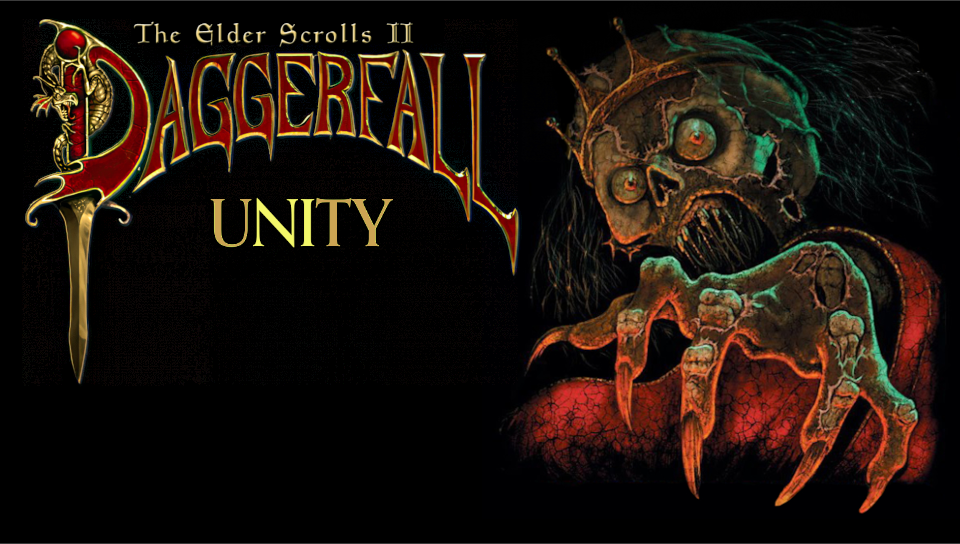
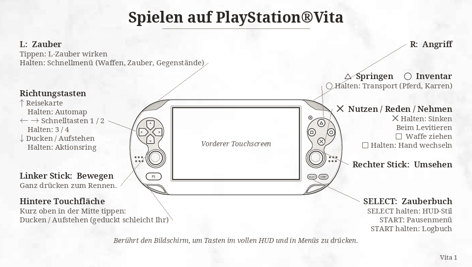
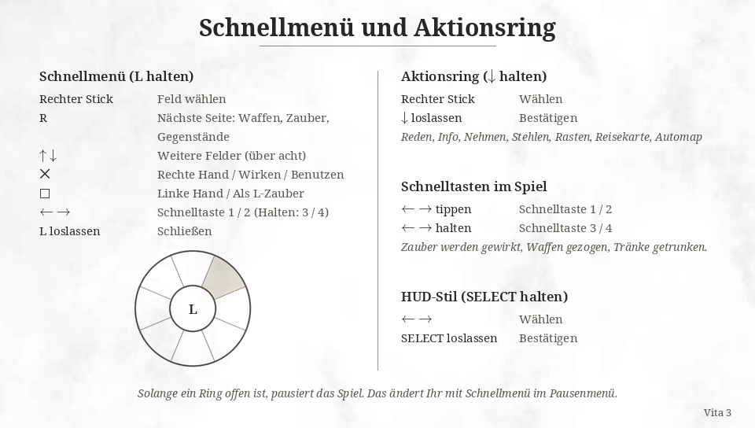

# Daggerfall Unity Vita

[English](README.md) | Deutsch | [Español](README.es.md) | [Français](README.fr.md) | [Italiano](README.it.md) | [Português](README.pt.md) | [中文](README.zh.md)

*Diese README wurde mit KI aus dem Englischen übersetzt. Im Zweifel gilt die [englische Fassung](README.md). Nur diese README ist KI-übersetzt: Das Spiel selbst nutzt die Übersetzung der Daggerfall-Unity-Übersetzer, siehe [Übersetzungen](#übersetzungen).*

<p align="center"></p>

Das ist eine Portierung von [Daggerfall Unity](https://github.com/Interkarma/daggerfall-unity), der Open-Source-Neuumsetzung von The Elder Scrolls II: Daggerfall, für die *PS Vita*.

Die Portierung läuft auf dem eigenen Unity-Player der Vita, es wird also nichts emuliert. Ich habe den Code von Upstream auf Unity 2018.2.19f1 zurückportiert und baue ihn mit IL2CPP. Das Spiel rendert in der nativen Auflösung von 960x544. Die meisten Spieldaten werden auf einem PC in Pakete für die Vita umgewandelt und liegen im VPK, das hält Ladezeiten und Speicherverbrauch niedrig.

Das ist eine Alpha, rechne also mit Fehlern. Sichere deine Spielstände vor jedem Update.

## Änderungen

### v.0.4.1-alpha

- Chinesisch: Kleiner Text im Schnellmenü, im Aktionsring, im HUD-Stil-Fenster, im Effekte-Fenster und im Steuerungsfenster verliert keine Striche mehr, und die Gegenstandsinfo im Inventar steht jetzt in einem gerahmten Kasten unter dem Porträt. Lange Hilfetexte bei der Charaktererstellung passen wieder auf den Bildschirm, sodass der Fertig-Knopf zu sehen ist. Danke an Lin für die Hinweise.
- Die Felsen und Berge von World of Daggerfall sind zurück. Sie fehlten seit 0.3.x.
- SphincterVision Snowless Swamp and Jungle (asphinctersayswhat) ersetzt die schneefreie Option, die ich für die Vita gebaut hatte: Im Winter bleiben Boden und Gebäude in Sümpfen und Dschungeln schneefrei, und dort regnet es statt zu schneien. Wer die alte Option genutzt hat, schaltet den neuen Mod unter Mods ein.
- Kleinere VPK: Der Testcode wird nicht mehr mitgeliefert.

<details>
<summary>Ältere Versionen</summary>

### v.0.4.0-alpha

- Neue Steuerung. Halte L für ein Schnellmenü mit deinen Waffen, Zaubern und Gegenständen, und halte das Steuerkreuz nach unten für einen Aktionsring mit Reden, Info, Nehmen, Stehlen, Rasten und den Karten. Steuerkreuz links und rechts belegen vier Schnelltasten. Siehe [Steuerung](#steuerung). Das Handbuch im LiveArea zeigt die neue Belegung ebenfalls.
- Die Tasten von Dragon Rider wurden passend geändert: R schießt einen Blitz, und kurzes Tippen auf L gibt einen Flügelschlag Tempo. Siehe [Dragon-Rider-Steuerung](#dragon-rider-steuerung).
- Portugiesisches VPK (Brasilien, `DFU-pt.vpk`), übersetzt von Equipe Adaga.
- Schneller mit Mods: im Schnitt 56 statt 49 FPS über dieselben 46 Stationen, und alle Ladebildschirme zusammen dauern 85 s statt 150 s. Siehe [Leistung](#leistung).
- 50 Änderungen aus dem Upstream-Daggerfall-Unity übernommen.
- Ein Einfrieren behoben, das auftrat, wenn dieselben Zauber immer wieder gewirkt wurden und viele Effekte aktiv waren.
- Dragon Rider: Ein Spielstand, der im Flug gespeichert wurde, setzt dich wieder auf dieselbe Höhe über dem Boden.
- Bäume, die zu weit weg sind, um sie zu sehen, werden nicht mehr gezeichnet. Das macht Wälder schneller.
- Die Blickempfindlichkeit ist standardmäßig höher. Du kannst sie im Pausenmenü ändern.

### v.0.3.2-alpha

Chinesisch, zwei neue Mods, eine neue Steuerkreuz-Belegung und einige Korrekturen.

- Chinesisches VPK (`DFU-zh.vpk`), übersetzt von Czy2007.
- Zwei neue Mods, beide standardmäßig aus: Dragon Rider (relentlessp0sitivity und Kamer) und Travel Options (Hazelnut). Schalte sie über die Schaltfläche „Mods“ im Einrichtungsbildschirm ein. Sie sind auf der Vita aufwendig und können die Bildrate senken. Siehe [Dragon-Rider-Steuerung](#dragon-rider-steuerung).
- Im chinesischen VPK sind die Meldungen von Dragon Rider und seine Quest The Stolen Egg auf Chinesisch. Zeilen, die der Übersetzer nicht übersetzt hat, bleiben englisch.
- Lange Meldungen oben im Bild brechen in eine zweite Zeile um, statt an beiden Rändern abgeschnitten zu werden.
- Steuerkreuz rechts öffnet die Reisekarte, Halten öffnet die Automap, und unten duckt dich oder lässt dich aufstehen. Tippen auf das hintere Touchpad duckt dich weiterhin auch.
- Bei der stärksten Zoomstufe der Reisekarte wählt der Cursor den Ort, auf den er zeigt, nicht einen ein paar Zeilen tiefer.
- Mit Dynamic Skies ist der helle Kasten um die Monde weg, und ferne Hügel am Horizont werden wieder vor einem aufgehenden Mond gezeichnet.

### v.0.3.1-alpha

Korrekturen für die übersetzten Versionen und eine Bildraten-Option.

- Neue Option „Bildrate“ im Pausenmenü: das Spiel für gleichmäßigen Ablauf auf 30 FPS festlegen oder offen lassen.
- Schnell ist jetzt die Standardeinstellung für den CPU/GPU-Takt. Den Modus „Schnell, ohne WLAN“ habe ich entfernt, weil das WLAN nach dem Verlassen des Spiels aus bleiben konnte. Wer ihn gewählt hatte, bekommt jetzt Schnell.
- Beenden im Pausenmenü führt jetzt immer zurück zum Titelbildschirm. Zum Schließen des Spiels die PS-Taste benutzen.
- Übersetzte Popups zeigen keine verirrten Fragezeichen mehr, und lange Zeilen bleiben im Bild.
- Buchstaben mit Akzent in der kleinen UI-Schrift sitzen nicht mehr unter der Zeile.
- Spanisch: neu beschriftete Menübilder, ein spanischer Titel auf der Rassenkarte und Korrekturen an Büchern, Klassenfragen und ein paar Tippfehlern.

### v.0.3.0-alpha

Eingebaute Mods und vier weitere Sprachen.

- Französisch, Deutsch, Italienisch und Spanisch, ein VPK pro Sprache. Menüs, Bücher, Quests, Dialoge, die Karte, Bilder und Filmuntertitel sind übersetzt.
- 21 Mods in die Portierung eingebaut, alle aus, bis du sie über die Schaltfläche „Mods“ im Einrichtungsbildschirm einschaltest. Siehe [Mods](#mods).
- Der Einrichtungsbildschirm öffnet sich beim ersten Start, damit neue Spieler die Schaltfläche „Mods“ finden.
- Lange übersetzte Beschriftungen werden verkleinert, bis sie in ihr Feld passen.
- Ein Streifen in Wasserfarbe auf fernen Hängen mit World of Daggerfall - Terrain ist behoben.
- Die Seite der Videoeinstellungen legt „Bildrate“ nicht mehr über die Schaltfläche „Schließen“.

### v.0.2.0-alpha

Vor allem flüssigeres Spielen: Städte bauen sich beim Gehen Stück für Stück auf, verborgene Bürger bewegen sich nicht mehr, Lieder laufen ohne Hänger in Schleife, weniger Ruckler durch die Speicherbereinigung und eine ruhigere Kamera.

### v.0.1.0-alpha

- Erste Veröffentlichung.

</details>

## Hinweis

Daggerfall Unity Vita ist ein inoffizielles Fanprojekt. Es steht in keiner Verbindung zu Bethesda Softworks, Sony oder Unity und wird von ihnen nicht unterstützt.

Zum Spielen brauchst du eine eigene Kopie von Daggerfall. DOS-Daggerfall gibt es kostenlos auf [Steam](https://store.steampowered.com/app/1812390/The_Elder_Scrolls_II_Daggerfall/).

Bitte melde Fehler dieser Portierung hier und nicht beim Daggerfall-Unity-Team.

## Einrichtung

Du brauchst eine Vita mit HENkaku oder Enso, auf der [VitaShell](https://github.com/TheOfficialFloW/VitaShell/releases) installiert ist, und etwa 2 GB freien Platz auf `ux0:` für die Installation. Spiel und Daten belegen etwa 1,4 GB, sobald du das VPK löschst.

- Lade ein VPK von der [Releases](https://github.com/GalvarinoDev/daggerfall-unity-vita/releases)-Seite herunter: `DFU-en.vpk` (Englisch), `DFU-fr.vpk` (Französisch), `DFU-de.vpk` (Deutsch), `DFU-it.vpk` (Italienisch), `DFU-es.vpk` (Spanisch), `DFU-pt.vpk` (Portugiesisch) oder `DFU-zh.vpk` (Chinesisch). Installiere es mit VitaShell. Alle sieben werden als dieselbe App installiert, beim Sprachwechsel bleiben Spielstände und Einstellungen also erhalten.
- Installiere DOS-Daggerfall auf deinem PC. Bei Steam ist der benötigte Ordner `DF/DAGGER/ARENA2` im Installationsordner des Spiels.
- Kopiere den ganzen Ordner `ARENA2` auf deine Vita, sodass du Folgendes hast:

```
ux0:data/DaggerfallUnity/ARENA2
```

- Starte das Spiel aus dem LiveArea. Das Laden der Engine kann etwa eine Minute dauern.

Das Originalhandbuch von 1996 ist dabei. Öffne es mit der Schaltfläche „Handbuch“ im LiveArea des Spiels. Das italienische VPK enthält das komplette italienische Handbuch.

Spielstände und Einstellungen liegen in `ux0:data/DaggerfallUnity/UserData`.

## Steuerung

<p align="center"></p>
<p align="center"></p>
<p align="center"></p>

Ein neues Spiel beginnt mit ausgeblendetem HUD. Halte Select, um einen HUD-Stil zu wählen, bewege dich nach links oder rechts und lass los. In einem Textfeld öffnet Dreieck die Systemtastatur wieder.

### Schnellmenü (L halten)

Halte L, um einen Ring mit deinen Waffen, Zaubern und Gegenständen zu öffnen. Zeige mit dem rechten Stick auf ein Feld und wechsle mit R zwischen Waffen, Zaubern und Gegenständen. Hat eine Seite mehr als acht Einträge, zeigen Steuerkreuz oben und unten den Rest. Lass L los, um den Ring zu schließen.

- Waffen: Kreuz legt die Waffe in die rechte Hand, Quadrat in die linke. Drückst du dieselbe Taste noch einmal, wird sie abgelegt. Das Feld „Hand wechseln“ tauscht sie.
- Zauber: Kreuz wirkt den Zauber. Quadrat macht ihn zu deinem L-Zauber, den du danach mit kurzem Tippen auf L wirkst. Das Feld „Zauberbuch“ öffnet das Zauberbuch.
- Gegenstände: Kreuz benutzt einen Trank oder magischen Gegenstand. Quadrat auf einem magischen Gegenstand legt seine Kraft auf L.
- Schnelltasten: Tippe auf jeder Seite Steuerkreuz links oder rechts, um das Feld auf Schnelltaste 1 oder 2 zu legen, oder halte die Taste für Schnelltaste 3 oder 4. Im Spiel lösen dieselben Tipps und Halten sie aus: Zauber werden gewirkt, Waffen gezogen und Tränke getrunken.

Standardmäßig pausiert das Spiel, solange der Ring offen ist. Mit „Schnellmenü“ im Pausenmenü stellst du stattdessen Echtzeit oder Zeitlupe ein.

### Aktionsring (Steuerkreuz unten halten)

Halte das Steuerkreuz nach unten für einen zweiten Ring mit Reden, Info, Nehmen, Stehlen, Rasten, der Reisekarte und der Automap. Zeige mit dem rechten Stick auf einen Eintrag und lass die Taste los, um ihn zu wählen. Kurzes Tippen nach unten duckt dich weiterhin oder lässt dich aufstehen.

### Dragon-Rider-Steuerung

Das gilt nur, wenn du die Mod Dragon Rider einschaltest (sie ist standardmäßig aus). Ohne sie gelten die Tasten wie oben.

- Aktiviere deinen Drachen im Modus Stehlen oder Nehmen, um aufzusteigen, oder im Modus Reden, damit er dir folgt, wartet oder einen Edelstein nimmt. Auf- und absteigen geht auch über das Transportmenü (Kreis halten).
- R schießt einen Blitz aus dem Element deines Drachen. Tippe L für einen Flügelschlag Tempo und tippe weiter, um es zu halten. L halten öffnet weiterhin das Schnellmenü.
- Dreieck steigt, Kreuz taucht ab.
- Tippe das Steuerkreuz nach unten, um zwischen Schweben und Fliegen zu wechseln.
- Schnippe den linken Stick kräftig zur Seite, um auszuweichen. Zweimal schnippen gibt eine Fassrolle.

## Mods

Die Vita kann keine PC-`.dfmod`-Dateien laden, darum wird jede Mod für sie umgewandelt. Schalte sie über die Schaltfläche „Mods“ im Einrichtungsbildschirm ein, bevor das Spiel lädt. Mod-Texte bleiben in jeder Sprache englisch, außer denen von Dragon Rider im chinesischen VPK.

Wenn eine Mod auf der Vita nicht funktioniert, liegt das sehr wahrscheinlich an einem Fehler, den ich beim Umwandeln gemacht habe. Bitte melde ihn hier und nicht beim Autor der Mod.

Ich packe jede Mod für die Vita neu und liefere sie nur in den Releases dieser Portierung aus, als optionale Mod. Texturen kommen in die 256-Farben-Palette von Daggerfall oder in die Texturformate der Vita und dann in Atlanten, und Modelle, Karten und andere Daten werden in die eigenen Pakete der Portierung umgewandelt. Die Originaldateien der Mods gebe ich nie weiter. Ihre Autoren behalten alle Rechte an ihrer Arbeit und haben die Erlaubnis nur für diese Portierung gegeben (siehe Lizenz).

Dragon Rider und Travel Options sind auf der Vita aufwendig und können die Bildrate senken.

<details>
<summary>Alle 23 Mods und ihre Autoren</summary>

| Mod | Version | Von | Links |
|---|---|---|---|
| Basic Roads | 1.3.1 | Hazelnut | [Nexus](https://www.nexusmods.com/daggerfallunity/mods/134), [GitHub](https://github.com/ajrb/dfunity-mods) |
| Beautiful Cities of Daggerfall | 0.5.0 | carademono | [Nexus](https://www.nexusmods.com/daggerfallunity/mods/720) |
| Beautiful Villages of Daggerfall | 1.4.2 | carademono | [Nexus](https://www.nexusmods.com/daggerfallunity/mods/566), [GitHub](https://github.com/drcarademono/beautiful-villages) |
| Daggerfall Expanded Textures | 1.3.0 | Ninelan-Ruinar | [Nexus](https://www.nexusmods.com/daggerfallunity/mods/307) |
| DET Harvestable Crops | 1.0.1 | carademono, Ninelan und TheLacus | [Nexus](https://www.nexusmods.com/daggerfallunity/mods/882) |
| DIEP - Rosy's Resources | 1.1 | AlexanderSig, BenGamey974, PRAEst76 und RosyTheRascal | [Nexus](https://www.nexusmods.com/daggerfallunity/mods/1053) |
| Distant Terrain of the World of Daggerfall | 3.69 | MaoDeVaca, basierend auf Nystuls [Distant Terrain](https://www.nexusmods.com/daggerfallunity/mods/128) | [Nexus](https://www.nexusmods.com/daggerfallunity/mods/1284) |
| Dragon Rider | 1.1 | relentlessp0sitivity und Kamer (SquidKamer) | [Nexus](https://www.nexusmods.com/daggerfallunity/mods/1334) |
| Dynamic Skies | 2.3.4 | BadLuckBurt und carademono | [Nexus](https://www.nexusmods.com/daggerfallunity/mods/376), [GitHub](https://github.com/drcarademono/dynamic-skies) |
| Finding My Religion | 1.23 | Cliffworms, mit Statuen von King of Worms | [Nexus](https://www.nexusmods.com/daggerfallunity/mods/344) |
| Fixed Desert Architecture | 1.3.7 | Cliffworms | [Nexus](https://www.nexusmods.com/daggerfallunity/mods/333) |
| Fixed Dungeon Exteriors | 1.4.4 | Cliffworms | [Nexus](https://www.nexusmods.com/daggerfallunity/mods/225) |
| Low Poly Trees | 5 | Kamer (SquidKamer) | [Nexus](https://www.nexusmods.com/daggerfallunity/mods/380) |
| Redguards of Hammerfell | 0.6 | WilhelmBlack | [Nexus](https://www.nexusmods.com/daggerfallunity/mods/666) |
| RMB Resource Pack | 0.3.0 | viele Asset-Ersteller, hochgeladen von Cliffworms und gepflegt von carademono | [Nexus](https://www.nexusmods.com/daggerfallunity/mods/528), [GitHub](https://github.com/drcarademono/rmb-resource-pack) |
| SphincterVision Snowless Swamp and Jungle | 1.2.1 | asphinctersayswhat | [Nexus](https://www.nexusmods.com/daggerfallunity/mods/735) |
| Travel Options | 1.11 | Hazelnut | [Nexus](https://www.nexusmods.com/daggerfallunity/mods/122), [GitHub](https://github.com/ajrb/dfunity-mods) |
| Vanilla Friendly Loading Screens | 1.1 | WilhelmBlack | [Nexus](https://www.nexusmods.com/daggerfallunity/mods/838) |
| Windmills of Daggerfall | 2.2 | Kamer (SquidKamer) | [Nexus](https://www.nexusmods.com/daggerfallunity/mods/33) |
| World of Daggerfall | 0.4.0 | World of Daggerfall Team: carademono, Cliffworms, JayH und Kamer, mit Location Loader von KABoissonneault und UncannyValley | [Nexus](https://www.nexusmods.com/daggerfallunity/mods/249), [GitHub](https://github.com/drcarademono/world-of-daggerfall), [Location Loader](https://github.com/KABoissonneault/DFU-LocationLoader) |
| World of Daggerfall - Biomes | 0.4.0 | carademono und KABoissonneault | [Nexus](https://www.nexusmods.com/daggerfallunity/mods/249), [GitHub](https://github.com/drcarademono/wod-biomes) |
| World of Daggerfall - Terrain | 1.5.0 | carademono, Freak2121, monobelisk und Ninelan | [Nexus](https://www.nexusmods.com/daggerfallunity/mods/249), [GitHub](https://github.com/drcarademono/wod-terrain) |

Ich habe jeden Mod-Autor oder Projektleiter um Erlaubnis gefragt. War ein Autor nicht erreichbar, steht die Mod aber unter der MIT-Lizenz, ist sie trotzdem dabei. Wenn du eine dieser Mods gemacht hast und sie lieber nicht in der Portierung sehen willst, eröffne ein Issue, und ich entferne sie.

Neu für die Vita ist Old Masters of Tamriel, eine Sammlung gemeinfreier Gemälde aus Wikimedia Commons.

World of Daggerfall - Terrain und Distant Terrain kosten die meiste Bildrate.

</details>

## Lichteinstellungen

<details>
<summary>Dungeonlicht, Fackeln und Feuerfarbe</summary>

Diese Optionen stehen in der Auswahlliste im Pausenmenü. Jeder Klick schaltet einen Eintrag auf den nächsten Wert, und die Änderung gilt sofort.

| Option | Werte | Standard |
|---|---|---|
| Dungeonlicht | 30 %, 50 %, 70 %, 100 % | 100 % |
| Feuerlicht (Fackeln und Laternen) | 50 %, 75 %, 100 %, 150 %, 200 % | 100 % |
| Feuerfarbe | Weiß, Leicht warm, Warm, Sehr warm | Weiß |
| Fackelreichweite | 6 m, 9 m, 12 m | 6 m |

Die Standardwerte entsprechen dem Aussehen von Daggerfall Unity auf dem PC.

</details>

## Leistung

<details>
<summary>Bildraten und Ladezeiten</summary>

Gemessen auf einer PCH-1000 mit 0.4.0. Ein Bot besuchte im Laufschritt dieselben 46 Stationen: einen Dungeon, die Wildnis sowie Daggerfall, Wayrest und Sentinel (Straßen mittags und nachts, Tavernen, Läden und Paläste). Für jede Station zählt der bessere von zwei Durchläufen.

| | Ohne Mods | Alle Mods |
|---|---|---|
| Durchschnitt | 59 FPS | 56 FPS |
| Tavernen, Läden, Paläste, Dungeon | 60 FPS | 60 FPS |
| Stadtstraßen | 52-60 FPS | 31-60 FPS |
| Wildnis | 46-60 FPS | 51-60 FPS |
| Alle Ladebildschirme zusammen | 81 s | 85 s |
| Längster einzelner Ladevorgang | 11 s | 11 s |

Zum Vergleich: 0.3.2 lief im Schnitt mit 58 FPS ohne Mods und 49 FPS mit allen, und seine Ladebildschirme dauerten zusammen 100 s und 150 s.

Kein Durchlauf ist abgestürzt. Die Standard-Geschwindigkeitseinstellung hebt die CPU auf 444 MHz und den GPU-Takt an und begrenzt die Bildschirmhelligkeit. Das kannst du mit „CPU/GPU-Takt“ im Pausenmenü ändern.

</details>

## Bekannte Probleme

- Im Schloss von Daggerfall ruckelt es an manchen Türen noch kurz.
- Webbrowser und PlayStation Store laufen nicht neben dem Spiel, weil es den zusätzlichen Speichermodus der Vita nutzt.
- Ersatzvideos, Post Processing und TextMeshPro-Schriften aus dem PC-Daggerfall-Unity gibt es nicht. Die Original-Zwischensequenzen laufen weiterhin.

## Selbst bauen

Die Anleitung steht auf Englisch in der [englischen README](README.md#building-it-yourself).

## Danksagung

- Meine Freundin. Ich habe mit der Portierung angefangen, weil sie sich meine Vita ausleihen wollte, als sie dieses Thanksgiving ihre Familie besuchte.
- [Interkarma](https://github.com/Interkarma), Daggerfall Workshop und alle Mitwirkenden an [Daggerfall Unity](https://github.com/Interkarma/daggerfall-unity).
- Bethesda Softworks für The Elder Scrolls II: Daggerfall.

### Übersetzungen

- Chinesisch: [Czy2007](https://www.nexusmods.com/daggerfallunity/users/230972787), [Chinese translation](https://www.nexusmods.com/daggerfallunity/mods/1418)
- Französisch: [Daneel53](https://www.nexusmods.com/daggerfallunity/users/6838829) ([GitHub](https://github.com/Daneel53)) und Pango, [French Daggerfall](https://www.nexusmods.com/daggerfallunity/mods/456)
- Deutsch: [Deepfighter](https://github.com/deepfighter) und Numenorean, [Daggerfall Deutsch](https://www.nexusmods.com/daggerfallunity/mods/826)
- Italienisch: [XSpettro101X](https://www.nexusmods.com/profile/XSpettro101X?gameId=2927), mit Bildern und Videos von [Rotary00](https://www.nexusmods.com/profile/Rotary00), [Traduzione Italiana](https://www.nexusmods.com/daggerfallunity/mods/1182)
- Portugiesisch (Brasilien): Equipe Adaga (Geavy, NecroBardo und Darkuby), hochgeladen von [Antony827](https://www.nexusmods.com/profile/Antony827?gameId=2927), [Tradução de Daggerfall Unity](https://www.nexusmods.com/daggerfallunity/mods/565)
- Spanisch: [raulpuro](https://forums.dfworkshop.net/memberlist.php?mode=viewprofile&u=1633), mit einigen Zeilen aus der [spanischen Übersetzung](https://www.nexusmods.com/daggerfallunity/mods/1251) von [NarrodRecandriall](https://github.com/Narrod-Dev)

Ich nehme gern weitere Sprachen auf, wenn die Übersetzer zustimmen. Wenn du eine Übersetzung von Daggerfall Unity gemacht hast und sie auf der Vita sehen möchtest, eröffne hier ein Issue oder schreib mir auf dem Discord-Server Lysandus' Tomb: DFU Fan Server.

### Mod-Autoren

Diese Autoren haben ihre Mods auf die Vita gelassen. Die Seite jeder Mod ist unter [Mods](#mods) verlinkt.

[AlexanderSig](https://www.nexusmods.com/profile/alexandersig?gameId=2927), [BadLuckBurt](https://github.com/BadLuckBurt), [BenGamey974](https://en.uesp.net/wiki/User:Bengamey_974), [carademono](https://www.nexusmods.com/daggerfallunity/users/107697598) ([GitHub](https://github.com/drcarademono)), [Cliffworms](https://www.nexusmods.com/daggerfallunity/users/13821) ([GitHub](https://github.com/Cliffworms)), [Freak2121](https://www.nexusmods.com/daggerfallunity/users/1626563) ([GitHub](https://github.com/Freak2121)), [Hazelnut](https://github.com/ajrb), [JayH](https://github.com/JayH2971), [KABoissonneault](https://www.nexusmods.com/daggerfallunity/users/5856175) ([GitHub](https://github.com/KABoissonneault)), [Kamer (SquidKamer)](https://github.com/SquidKamer), [King of Worms](https://www.nexusmods.com/profile/KingOfWormsDFU?gameId=2927), [MaoDeVaca](https://www.nexusmods.com/daggerfallunity/users/98208923), [monobelisk](https://www.nexusmods.com/daggerfallunity/users/14045140) ([GitHub](https://github.com/monobelisk)), [Ninelan-Ruinar](https://www.nexusmods.com/daggerfallunity/users/39888770), [Nystul](https://www.nexusmods.com/daggerfallunity/users/91388288) ([GitHub](https://github.com/Nystul-the-Magician)), [PRAEst76](https://www.nexusmods.com/daggerfallunity/users/56241), [RosyTheRascal](https://www.nexusmods.com/daggerfallunity/users/50021166), [TheLacus](https://github.com/TheLacus), [UncannyValley](https://forums.dfworkshop.net/memberlist.php?mode=viewprofile&u=72) und [WilhelmBlack](https://www.nexusmods.com/profile/WilhelmBlack?gameId=2927).

### Hilfe bei der Portierung

- [AJ](https://github.com/AJ170) und der Server PS Vita Forever.
- [Vwing](https://github.com/Vwing) für Ideen aus der Android-Portierung von Daggerfall Unity, die Vwing gemacht hat.
- [Kenney](https://www.kenney.nl) für das Paket [Input Prompts](https://kenney.nl/assets/input-prompts) (CC0). Die Tastensymbole im Schnellmenü basieren darauf.
- [shoui520](https://github.com/shoui520) für [vita-agent-use](https://github.com/shoui520/vita-agent-use). Damit kann ein KI-Assistent eine Vita steuern, und ich habe es mit einem für Belastungstests und Hardware-Diagnose genutzt: Testversionen aufspielen, nachts einen Bot hindurchlaufen lassen und danach die Absturzberichte und Bildraten-Logs auswerten. Das Spiel ist etwa so groß wie Großbritannien und ich kann nicht jeden Ort selbst besuchen, also hat das viele Abstürze und langsame Stellen gefunden, die ich von Hand nie entdeckt hätte.

## Lizenz

Der Code der Portierung steht unter MIT, wie Upstream-Daggerfall-Unity. Siehe [LICENSE](./LICENSE).

Die Lizenz gilt nur für den Code. Sie gilt weder für die Spieldaten noch für die Mods, ob umgewandelt oder nicht, und beides ist nicht in diesem Repository. Die Mods gehören ihren Autoren, die die Erlaubnis nur für diese Portierung gegeben haben. Wer sie in einem Fork oder anderswo verwenden will, muss zuerst die Autoren fragen.
