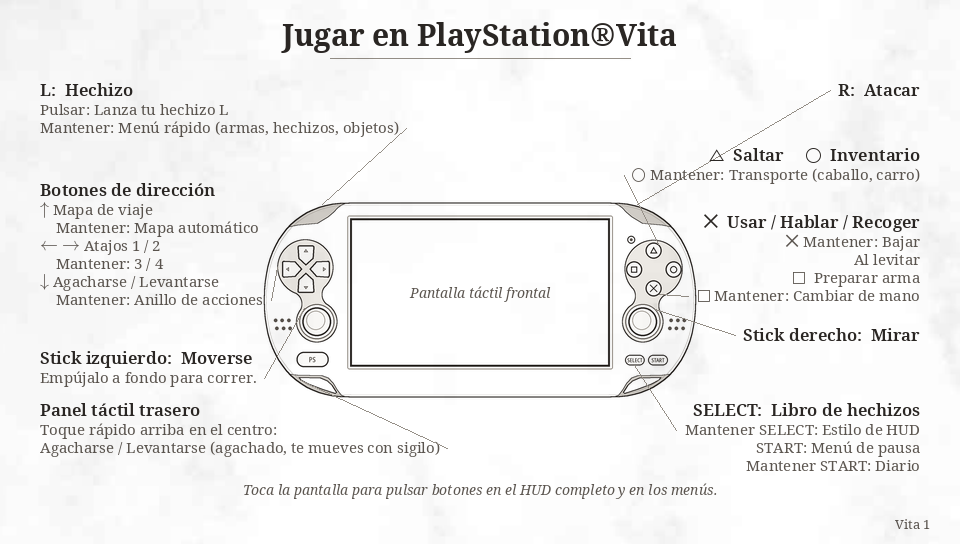
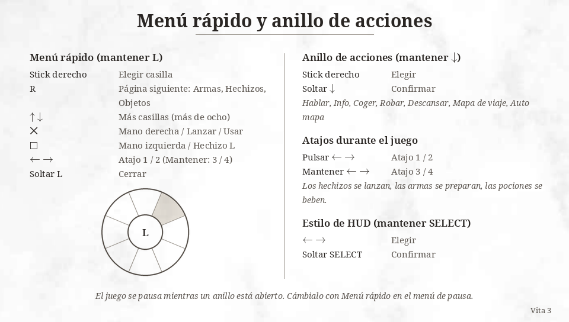

# Daggerfall Unity Vita

[English](README.md) | [Deutsch](README.de.md) | Español | [Français](README.fr.md) | [Italiano](README.it.md) | [Português](README.pt.md) | [中文](README.zh.md)

*Este README se tradujo del inglés con IA. Si hay dudas, manda la [versión en inglés](README.md). Solo este README está traducido con IA: el juego usa la traducción hecha por los traductores de Daggerfall Unity, mira [Traducciones](#traducciones).*

<p align="center"></p>

Esto es un port de [Daggerfall Unity](https://github.com/Interkarma/daggerfall-unity), la recreación de código abierto de The Elder Scrolls II: Daggerfall, para *PS Vita*.

El port funciona sobre el propio reproductor de Unity de la Vita, así que no se emula nada. Pasé el código de upstream a Unity 2018.2.19f1 y lo compilo con IL2CPP. El juego se ve a la resolución nativa de 960x544. Casi todos los datos del juego se convierten en un PC a paquetes hechos para la Vita y van dentro del VPK, lo que reduce los tiempos de carga y el uso de memoria.

Es una alfa, así que habrá errores. Haz copia de tus partidas antes de actualizar.

## Novedades

### v.0.4.1-alpha

- Chino: el texto pequeño del menú rápido, el anillo de acciones, la ventana de estilo del HUD, la ventana de efectos y la de controles ya no pierde trazos, y la información de objetos del inventario ahora va en un recuadro con marco bajo el retrato. Los textos de ayuda largos de la creación de personaje vuelven a caber en la pantalla y se ve el botón de terminar. Gracias a Lin por los avisos.
- Vuelven las rocas y montañas de World of Daggerfall. Faltaban desde la 0.3.x.
- SphincterVision Snowless Swamp and Jungle (asphinctersayswhat) sustituye a la opción sin nieve que hice para la Vita: en invierno, los pantanos y las selvas conservan el suelo y los edificios sin nieve, y allí llueve en vez de nevar. Si usabas la opción antigua, activa el nuevo mod en Mods.
- VPK más pequeño: el código de pruebas ya no viene con el juego.

<details>
<summary>Versiones anteriores</summary>

### v.0.4.0-alpha

- Controles nuevos. Mantén L para un menú rápido con tus armas, hechizos y objetos, y mantén abajo en la cruceta para un anillo de acciones con Hablar, Info, Coger, Robar, Descansar y los mapas. Izquierda y derecha en la cruceta guardan cuatro atajos. Mira [Controles](#controles). El manual del LiveArea también trae la nueva distribución.
- Los botones de Dragon Rider cambian a juego: R dispara un rayo, y un toque de L da un aletazo de velocidad. Mira [Controles de Dragon Rider](#controles-de-dragon-rider).
- VPK en portugués (Brasil, `DFU-pt.vpk`), traducido por Equipe Adaga.
- Más rápido con mods: 56 FPS de media en vez de 49 en las mismas 46 paradas, y todas las pantallas de carga juntas suman 85 s en vez de 150 s. Mira [Rendimiento](#rendimiento).
- 50 cambios de Daggerfall Unity (upstream) incorporados.
- Arreglado un cuelgue que pasaba al lanzar los mismos hechizos una y otra vez con muchos efectos activos.
- Dragon Rider: cargar una partida guardada en pleno vuelo te deja a la misma altura sobre el suelo.
- Los árboles demasiado lejos para verse ya no se dibujan, lo que acelera los bosques.
- La sensibilidad ocular es más alta por defecto. Puedes cambiarla en el menú de pausa.

### v.0.3.2-alpha

Chino, dos mods nuevos, una nueva distribución de la cruceta y algunos arreglos.

- VPK en chino (`DFU-zh.vpk`), traducido por Czy2007.
- Dos mods nuevos, los dos desactivados por defecto: Dragon Rider (relentlessp0sitivity y Kamer) y Travel Options (Hazelnut). Actívalos con el botón Mods de la pantalla de configuración. Pesan mucho en la Vita y pueden bajar la tasa de fotogramas. Mira [Controles de Dragon Rider](#controles-de-dragon-rider).
- En el VPK chino, los mensajes de Dragon Rider y su misión, The Stolen Egg, están en chino. Las líneas que el traductor no cubrió siguen en inglés.
- Los mensajes largos de la parte de arriba de la pantalla pasan a una segunda línea en vez de salirse por los dos lados.
- Derecha en la cruceta abre el mapa de viaje, mantenerla abre el auto mapa, y abajo sirve para agacharte o levantarte. Tocar el panel táctil trasero también sigue agachándote.
- Con el zoom más cercano del mapa de viaje, el cursor elige el sitio al que apunta, no uno unas filas más abajo.
- Con Dynamic Skies, ya no hay un recuadro claro alrededor de las lunas, y las colinas lejanas del horizonte vuelven a dibujarse delante de una luna que sale.

### v.0.3.1-alpha

Arreglos para las versiones traducidas y una opción de tasa de fotogramas.

- Nueva opción Tasa de fotogramas en el menú de pausa: fija el juego a 30 FPS para un ritmo uniforme, o déjalo libre.
- Rápido es ahora la velocidad CPU/GPU por defecto. Quité el modo «Rápido, sin Wi-Fi» porque el Wi-Fi podía quedarse apagado al salir del juego. Si lo tenías elegido, ahora tienes Rápido.
- Salir en el menú de pausa ahora siempre te lleva a la pantalla de título. Para cerrar el juego, usa el botón PS.
- Las ventanas traducidas ya no muestran signos de interrogación sueltos, y las líneas largas se quedan en pantalla.
- Las letras con tilde de la fuente pequeña de la interfaz ya no quedan por debajo de la línea.
- Español: imágenes de menú rotuladas de nuevo, un título en español en el mapa de razas y arreglos en libros, preguntas de clase y algunas erratas.

### v.0.3.0-alpha

Mods integrados y cuatro idiomas más.

- Francés, alemán, italiano y español, un VPK por idioma. Menús, libros, misiones, diálogos, el mapa, imágenes y subtítulos de los vídeos están traducidos.
- 21 mods integrados en el port, todos desactivados hasta que los actives con el botón Mods de la pantalla de configuración. Mira [Mods](#mods).
- La pantalla de configuración se abre la primera vez que arrancas, para que los jugadores nuevos encuentren el botón Mods.
- Las etiquetas traducidas largas se encogen para caber en su recuadro.
- Arreglada una franja de color agua en las laderas lejanas con World of Daggerfall - Terrain.
- La página de ajustes de vídeo ya no pone Tasa de fotogramas encima del botón Cerrar.

### v.0.2.0-alpha

Sobre todo un juego más fluido: las ciudades se construyen poco a poco mientras caminas, los ciudadanos ocultos dejan de moverse, las canciones se repiten sin congelarse, hay menos tirones por la recolección de basura y la cámara va más suave.

### v.0.1.0-alpha

- Primera versión.

</details>

## Aviso

Daggerfall Unity Vita es un proyecto de fans no oficial. No tiene relación con Bethesda Softworks, Sony ni Unity, ni cuenta con su respaldo.

Necesitas tu propia copia de Daggerfall para jugar. Daggerfall para DOS es gratis en [Steam](https://store.steampowered.com/app/1812390/The_Elder_Scrolls_II_Daggerfall/).

Por favor, informa de los errores de este port aquí, no al equipo de Daggerfall Unity.

## Instalación

Necesitas una Vita con HENkaku o Enso y [VitaShell](https://github.com/TheOfficialFloW/VitaShell/releases) instalado, y unos 2 GB libres en `ux0:` para la instalación. El juego y sus datos ocupan unos 1,4 GB cuando borras el VPK.

- Descarga un VPK de la página de [Releases](https://github.com/GalvarinoDev/daggerfall-unity-vita/releases): `DFU-en.vpk` (inglés), `DFU-fr.vpk` (francés), `DFU-de.vpk` (alemán), `DFU-it.vpk` (italiano), `DFU-es.vpk` (español), `DFU-pt.vpk` (portugués) o `DFU-zh.vpk` (chino). Instálalo con VitaShell. Los siete se instalan como la misma aplicación, así que al cambiar de idioma conservas tus partidas y ajustes.
- Instala Daggerfall para DOS en tu PC. En Steam, la carpeta que necesitas es `DF/DAGGER/ARENA2` dentro de la carpeta de instalación del juego.
- Copia la carpeta `ARENA2` entera a tu Vita, para que quede así:

```
ux0:data/DaggerfallUnity/ARENA2
```

- Abre el juego desde el LiveArea. La carga del motor puede tardar alrededor de un minuto.

Incluye el manual original de 1996. Ábrelo con el botón Manual de la pantalla LiveArea del juego. El VPK italiano trae el manual italiano completo.

El juego guarda las partidas y los ajustes en `ux0:data/DaggerfallUnity/UserData`.

## Controles

<p align="center"></p>
<p align="center"></p>
<p align="center"></p>

Una partida nueva empieza con el HUD oculto. Mantén Select para elegir un estilo de HUD, muévete a la izquierda o a la derecha para escoger uno y suelta. En un cuadro de texto, Triángulo vuelve a abrir el teclado del sistema.

### Menú rápido (mantener L)

Mantén L para abrir un anillo con tus armas, hechizos y objetos. Apunta a una casilla con el stick derecho y pulsa R para pasar entre Armas, Hechizos y Objetos. Si una página tiene más de ocho cosas, arriba y abajo en la cruceta muestran el resto. Suelta L para cerrarlo.

- Armas: Cruz pone el arma en la mano derecha y Cuadrado en la izquierda. Si vuelves a pulsar el mismo botón, te la quitas. La casilla Cambiar de mano las intercambia.
- Hechizos: Cruz lanza el hechizo. Cuadrado lo convierte en tu hechizo de L, que a partir de entonces lanzas con un toque de L. La casilla Libro de hechizos abre el libro de hechizos.
- Objetos: Cruz usa una poción u objeto mágico. Cuadrado sobre un objeto mágico pone su poder en L.
- Atajos: en cualquier página, toca izquierda o derecha en la cruceta para poner la casilla en el atajo 1 o 2, o mantén para el 3 o el 4. Jugando, los mismos toques y pulsaciones largas los usan: se lanzan hechizos, se desenvainan armas y se beben pociones.

Por defecto el juego se pausa mientras el anillo está abierto. Puedes cambiarlo a tiempo real o cámara lenta con Menú rápido en el menú de pausa.

### Anillo de acciones (mantener abajo en la cruceta)

Mantén abajo en la cruceta para un segundo anillo con Hablar, Info, Coger, Robar, Descansar, el mapa de viaje y el auto mapa. Apunta a uno con el stick derecho y suelta abajo para elegirlo. Un toque rápido hacia abajo sigue sirviendo para agacharte o levantarte.

### Controles de Dragon Rider

Solo se aplican si activas el mod Dragon Rider (viene desactivado). Sin él, los botones funcionan como se ve arriba.

- Activa a tu dragón en modo Robar o Coger para montarlo, o en modo Hablar para decirle que te siga, espere o coja una gema. También puedes montar y desmontar desde el menú de transporte (mantener Círculo).
- R dispara un rayo del elemento de tu dragón. Toca L para un aletazo de velocidad y sigue tocando para mantenerla. Mantener L sigue abriendo el menú rápido.
- Triángulo sube y Cruz baja en picado.
- Toca abajo en la cruceta para cambiar entre flotar y volar.
- Mueve el stick izquierdo de golpe hacia un lado para esquivar. Dos veces seguidas hacen un tonel.

## Mods

La Vita no puede cargar los archivos `.dfmod` de PC, así que cada mod se convierte para ella. Actívalos con el botón Mods de la pantalla de configuración, antes de que cargue el juego. Los textos de los mods se quedan en inglés en todos los idiomas, menos los de Dragon Rider en el VPK chino.

Si un mod falla en la Vita, lo más probable es que sea un error mío al convertirlo. Por favor, avisa aquí, no al autor del mod.

Vuelvo a empaquetar cada mod para la Vita y solo lo distribuyo dentro de las versiones de este port, como mod opcional. Las texturas pasan a la paleta de 256 colores de Daggerfall o a los formatos de textura de la Vita y luego a atlas, y los modelos, mapas y demás datos se convierten a los paquetes propios del port. Nunca comparto los archivos originales de los mods. Sus autores conservan todos los derechos sobre su trabajo y dieron permiso solo para este port (mira Licencia).

Dragon Rider y Travel Options pesan mucho en la Vita y pueden bajar la tasa de fotogramas.

<details>
<summary>Los 23 mods y sus autores</summary>

| Mod | Version | Por | Enlaces |
|---|---|---|---|
| Basic Roads | 1.3.1 | Hazelnut | [Nexus](https://www.nexusmods.com/daggerfallunity/mods/134), [GitHub](https://github.com/ajrb/dfunity-mods) |
| Beautiful Cities of Daggerfall | 0.5.0 | carademono | [Nexus](https://www.nexusmods.com/daggerfallunity/mods/720) |
| Beautiful Villages of Daggerfall | 1.4.2 | carademono | [Nexus](https://www.nexusmods.com/daggerfallunity/mods/566), [GitHub](https://github.com/drcarademono/beautiful-villages) |
| Daggerfall Expanded Textures | 1.3.0 | Ninelan-Ruinar | [Nexus](https://www.nexusmods.com/daggerfallunity/mods/307) |
| DET Harvestable Crops | 1.0.1 | carademono, Ninelan y TheLacus | [Nexus](https://www.nexusmods.com/daggerfallunity/mods/882) |
| DIEP - Rosy's Resources | 1.1 | AlexanderSig, BenGamey974, PRAEst76 y RosyTheRascal | [Nexus](https://www.nexusmods.com/daggerfallunity/mods/1053) |
| Distant Terrain of the World of Daggerfall | 3.69 | MaoDeVaca, basado en [Distant Terrain](https://www.nexusmods.com/daggerfallunity/mods/128) de Nystul | [Nexus](https://www.nexusmods.com/daggerfallunity/mods/1284) |
| Dragon Rider | 1.1 | relentlessp0sitivity y Kamer (SquidKamer) | [Nexus](https://www.nexusmods.com/daggerfallunity/mods/1334) |
| Dynamic Skies | 2.3.4 | BadLuckBurt y carademono | [Nexus](https://www.nexusmods.com/daggerfallunity/mods/376), [GitHub](https://github.com/drcarademono/dynamic-skies) |
| Finding My Religion | 1.23 | Cliffworms, con estatuas de King of Worms | [Nexus](https://www.nexusmods.com/daggerfallunity/mods/344) |
| Fixed Desert Architecture | 1.3.7 | Cliffworms | [Nexus](https://www.nexusmods.com/daggerfallunity/mods/333) |
| Fixed Dungeon Exteriors | 1.4.4 | Cliffworms | [Nexus](https://www.nexusmods.com/daggerfallunity/mods/225) |
| Low Poly Trees | 5 | Kamer (SquidKamer) | [Nexus](https://www.nexusmods.com/daggerfallunity/mods/380) |
| Redguards of Hammerfell | 0.6 | WilhelmBlack | [Nexus](https://www.nexusmods.com/daggerfallunity/mods/666) |
| RMB Resource Pack | 0.3.0 | muchos creadores, subido por Cliffworms y mantenido por carademono | [Nexus](https://www.nexusmods.com/daggerfallunity/mods/528), [GitHub](https://github.com/drcarademono/rmb-resource-pack) |
| SphincterVision Snowless Swamp and Jungle | 1.2.1 | asphinctersayswhat | [Nexus](https://www.nexusmods.com/daggerfallunity/mods/735) |
| Travel Options | 1.11 | Hazelnut | [Nexus](https://www.nexusmods.com/daggerfallunity/mods/122), [GitHub](https://github.com/ajrb/dfunity-mods) |
| Vanilla Friendly Loading Screens | 1.1 | WilhelmBlack | [Nexus](https://www.nexusmods.com/daggerfallunity/mods/838) |
| Windmills of Daggerfall | 2.2 | Kamer (SquidKamer) | [Nexus](https://www.nexusmods.com/daggerfallunity/mods/33) |
| World of Daggerfall | 0.4.0 | World of Daggerfall Team: carademono, Cliffworms, JayH y Kamer, con Location Loader de KABoissonneault y UncannyValley | [Nexus](https://www.nexusmods.com/daggerfallunity/mods/249), [GitHub](https://github.com/drcarademono/world-of-daggerfall), [Location Loader](https://github.com/KABoissonneault/DFU-LocationLoader) |
| World of Daggerfall - Biomes | 0.4.0 | carademono y KABoissonneault | [Nexus](https://www.nexusmods.com/daggerfallunity/mods/249), [GitHub](https://github.com/drcarademono/wod-biomes) |
| World of Daggerfall - Terrain | 1.5.0 | carademono, Freak2121, monobelisk y Ninelan | [Nexus](https://www.nexusmods.com/daggerfallunity/mods/249), [GitHub](https://github.com/drcarademono/wod-terrain) |

Pedí permiso al autor o responsable de cada mod. Si no pude contactar con un autor pero el mod tiene licencia MIT, está incluido igualmente. Si hiciste uno de estos mods y prefieres que lo quite del port, abre una issue y lo quitaré.

Uno es nuevo para la Vita: Old Masters of Tamriel, una colección de cuadros de dominio público de Wikimedia Commons.

World of Daggerfall - Terrain y Distant Terrain son los que más fotogramas cuestan.

</details>

## Ajustes de luz

<details>
<summary>Luz de mazmorra, antorchas y color del fuego</summary>

Están en la lista desplegable del menú de pausa. Cada clic pasa la opción a su siguiente valor, y el cambio se aplica al momento.

| Opción | Valores | Por defecto |
|---|---|---|
| Luz de mazmorra | 30 %, 50 %, 70 %, 100 % | 100 % |
| Luz del fuego (antorchas y faroles) | 50 %, 75 %, 100 %, 150 %, 200 % | 100 % |
| Color del fuego | Blanco, Algo cálido, Cálido, Muy cálido | Blanco |
| Alcance de la antorcha | 6 m, 9 m, 12 m | 6 m |

Los valores por defecto imitan el aspecto de Daggerfall Unity en PC.

</details>

## Rendimiento

<details>
<summary>Fotogramas por segundo y tiempos de carga</summary>

Medido en una PCH-1000 con la 0.4.0. Un bot recorrió corriendo las mismas 46 paradas: una mazmorra, el campo, y Daggerfall, Wayrest y Sentinel (calles a mediodía y de noche, tabernas, tiendas y palacios). En cada parada cuenta la mejor de dos pasadas.

| | Sin mods | Todos los mods |
|---|---|---|
| Media | 59 FPS | 56 FPS |
| Tabernas, tiendas, palacios, mazmorra | 60 FPS | 60 FPS |
| Calles de ciudad | 52-60 FPS | 31-60 FPS |
| Campo | 46-60 FPS | 51-60 FPS |
| Todas las pantallas de carga juntas | 81 s | 85 s |
| Carga más larga | 11 s | 11 s |

Para comparar, la 0.3.2 iba de media a 58 FPS sin mods y 49 FPS con todos, y sus pantallas de carga sumaban 100 s y 150 s.

Ninguna pasada se colgó. El ajuste de velocidad por defecto sube la CPU a 444 MHz y la frecuencia de la GPU, y limita el brillo de la pantalla. Puedes cambiarlo con Velocidad CPU/GPU en el menú de pausa.

</details>

## Problemas conocidos

- El castillo de Daggerfall todavía da pequeños tirones en algunas puertas.
- El navegador web y la PlayStation Store no pueden funcionar a la vez que el juego, porque usa el modo de memoria extra de la Vita.
- Los vídeos de reemplazo, el Post Processing y las fuentes TextMeshPro de Daggerfall Unity para PC no están disponibles. Las cinemáticas originales siguen funcionando.

## Compilarlo tú mismo

Las instrucciones están en inglés en el [README en inglés](README.md#building-it-yourself).

## Créditos

- Mi novia. Empecé el port porque iba a llevarse prestada mi Vita cuando visitara a su familia este Acción de Gracias.
- [Interkarma](https://github.com/Interkarma), Daggerfall Workshop y todos los que han contribuido a [Daggerfall Unity](https://github.com/Interkarma/daggerfall-unity).
- Bethesda Softworks por The Elder Scrolls II: Daggerfall.

### Traducciones

- Chino: [Czy2007](https://www.nexusmods.com/daggerfallunity/users/230972787), [Chinese translation](https://www.nexusmods.com/daggerfallunity/mods/1418)
- Francés: [Daneel53](https://www.nexusmods.com/daggerfallunity/users/6838829) ([GitHub](https://github.com/Daneel53)) y Pango, [French Daggerfall](https://www.nexusmods.com/daggerfallunity/mods/456)
- Alemán: [Deepfighter](https://github.com/deepfighter) y Numenorean, [Daggerfall Deutsch](https://www.nexusmods.com/daggerfallunity/mods/826)
- Italiano: [XSpettro101X](https://www.nexusmods.com/profile/XSpettro101X?gameId=2927), con imágenes y vídeos de [Rotary00](https://www.nexusmods.com/profile/Rotary00), [Traduzione Italiana](https://www.nexusmods.com/daggerfallunity/mods/1182)
- Portugués (Brasil): Equipe Adaga (Geavy, NecroBardo y Darkuby), subido por [Antony827](https://www.nexusmods.com/profile/Antony827?gameId=2927), [Tradução de Daggerfall Unity](https://www.nexusmods.com/daggerfallunity/mods/565)
- Español: [raulpuro](https://forums.dfworkshop.net/memberlist.php?mode=viewprofile&u=1633), con algunas líneas de la [traducción al español](https://www.nexusmods.com/daggerfallunity/mods/1251) de [NarrodRecandriall](https://github.com/Narrod-Dev)

Añadiré más idiomas con gusto si sus traductores están de acuerdo. Si hiciste una traducción de Daggerfall Unity y te gustaría verla en la Vita, abre una issue aquí o escríbeme en el Discord Lysandus' Tomb: DFU Fan Server.

### Autores de los mods

Estos autores dejaron que sus mods llegaran a la Vita. La página de cada mod está enlazada en [Mods](#mods).

[AlexanderSig](https://www.nexusmods.com/profile/alexandersig?gameId=2927), [BadLuckBurt](https://github.com/BadLuckBurt), [BenGamey974](https://en.uesp.net/wiki/User:Bengamey_974), [carademono](https://www.nexusmods.com/daggerfallunity/users/107697598) ([GitHub](https://github.com/drcarademono)), [Cliffworms](https://www.nexusmods.com/daggerfallunity/users/13821) ([GitHub](https://github.com/Cliffworms)), [Freak2121](https://www.nexusmods.com/daggerfallunity/users/1626563) ([GitHub](https://github.com/Freak2121)), [Hazelnut](https://github.com/ajrb), [JayH](https://github.com/JayH2971), [KABoissonneault](https://www.nexusmods.com/daggerfallunity/users/5856175) ([GitHub](https://github.com/KABoissonneault)), [Kamer (SquidKamer)](https://github.com/SquidKamer), [King of Worms](https://www.nexusmods.com/profile/KingOfWormsDFU?gameId=2927), [MaoDeVaca](https://www.nexusmods.com/daggerfallunity/users/98208923), [monobelisk](https://www.nexusmods.com/daggerfallunity/users/14045140) ([GitHub](https://github.com/monobelisk)), [Ninelan-Ruinar](https://www.nexusmods.com/daggerfallunity/users/39888770), [Nystul](https://www.nexusmods.com/daggerfallunity/users/91388288) ([GitHub](https://github.com/Nystul-the-Magician)), [PRAEst76](https://www.nexusmods.com/daggerfallunity/users/56241), [RosyTheRascal](https://www.nexusmods.com/daggerfallunity/users/50021166), [TheLacus](https://github.com/TheLacus), [UncannyValley](https://forums.dfworkshop.net/memberlist.php?mode=viewprofile&u=72) y [WilhelmBlack](https://www.nexusmods.com/profile/WilhelmBlack?gameId=2927).

### Ayuda con el port

- [AJ](https://github.com/AJ170) y el servidor PS Vita Forever.
- [Vwing](https://github.com/Vwing) por las ideas de su port de Daggerfall Unity para Android.
- [Kenney](https://www.kenney.nl) por el pack [Input Prompts](https://kenney.nl/assets/input-prompts) (CC0). Los iconos de botones del menú rápido se basan en él.
- [shoui520](https://github.com/shoui520) por [vita-agent-use](https://github.com/shoui520/vita-agent-use). Permite que un asistente de IA controle una Vita, y lo usé con uno para pruebas de estrés y diagnóstico del hardware: instalar versiones de prueba, dejar un bot recorriéndolas por la noche y luego leer los volcados de cuelgues y los registros de FPS. El juego es más o menos del tamaño del Reino Unido y no puedo visitar cada sitio yo mismo, así que salieron muchos cuelgues y zonas lentas que a mano nunca habría encontrado.

## Licencia

El código del port es MIT, igual que Daggerfall Unity (upstream). Mira [LICENSE](./LICENSE).

La licencia solo cubre el código. No cubre los datos del juego ni los mods, convertidos o no, y ninguno de los dos está en este repositorio. Los mods son de sus autores, que dieron permiso solo para este port, así que quien quiera usarlos en un fork o en cualquier otro sitio tiene que pedírselo antes a los autores.
