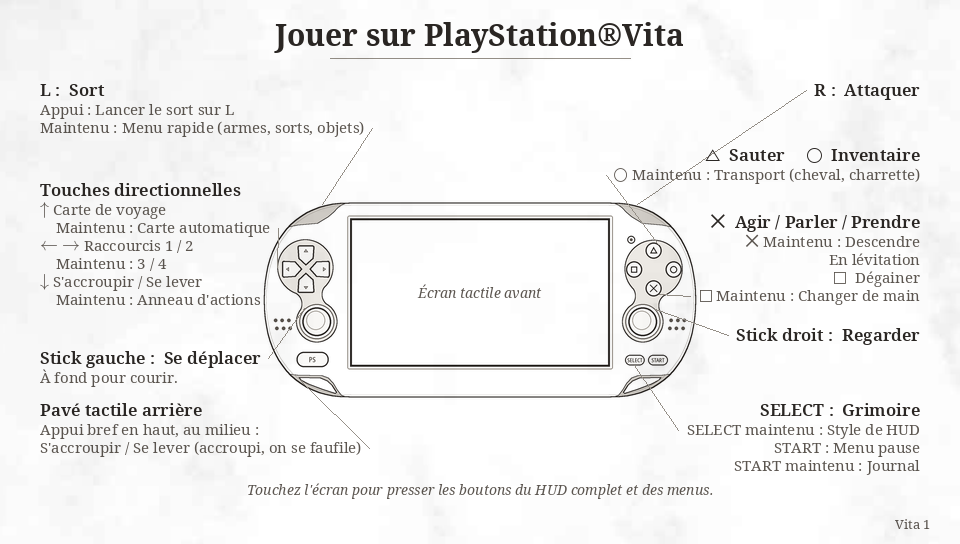
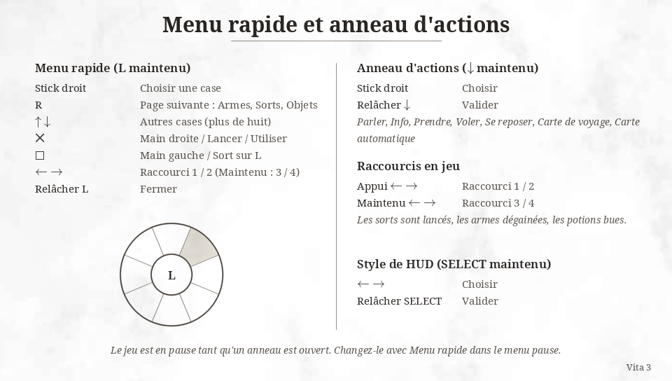

# Daggerfall Unity Vita

[English](README.md) | [Deutsch](README.de.md) | [Español](README.es.md) | Français | [Italiano](README.it.md) | [Português](README.pt.md) | [中文](README.zh.md)

*Ce README a été traduit de l'anglais avec une IA. En cas de doute, la [version anglaise](README.md) fait foi. Seul ce README est traduit par IA : le jeu utilise la traduction faite par les traducteurs de Daggerfall Unity, voir [Traductions](#traductions).*

<p align="center"></p>

Voici un portage de [Daggerfall Unity](https://github.com/Interkarma/daggerfall-unity), la recréation open source de The Elder Scrolls II: Daggerfall, pour la *PS Vita*.

Le portage tourne sur le lecteur Unity de la Vita elle-même, donc rien n'est émulé. J'ai rétroporté le code d'upstream vers Unity 2018.2.19f1 et je le compile avec IL2CPP. Le jeu s'affiche dans la résolution native de 960x544. La plupart des données du jeu sont converties sur PC en paquets faits pour la Vita et livrées dans le VPK, ce qui réduit les temps de chargement et la mémoire utilisée.

C'est une alpha, attendez-vous donc à des bugs. Sauvegardez vos parties avant chaque mise à jour.

## Nouveautés

### v.0.4.1-alpha

- Chinois : les petits textes du menu rapide, de l'anneau d'actions, de la fenêtre de style du HUD, de la fenêtre des effets et de celle des commandes ne perdent plus de traits, et les infos d'objet de l'inventaire s'affichent dans un cadre sous le portrait. Les longs textes d'aide de la création de personnage tiennent de nouveau à l'écran, et le bouton de fin est visible. Merci à Lin pour les signalements.
- Les rochers et les montagnes de World of Daggerfall sont de retour. Ils manquaient depuis la 0.3.x.
- SphincterVision Snowless Swamp and Jungle (asphinctersayswhat) remplace l'option sans neige que j'avais faite pour la Vita : en hiver, les marais et les jungles gardent un sol et des bâtiments sans neige, et il y pleut au lieu de neiger. Si vous utilisiez l'ancienne option, activez le nouveau mod dans Mods.
- VPK plus léger : le code de test n'est plus livré avec le jeu.

<details>
<summary>Versions précédentes</summary>

### v.0.4.0-alpha

- Nouvelles commandes. Maintenez L pour un menu rapide avec vos armes, sorts et objets, et maintenez le bas de la croix directionnelle pour un anneau d'actions avec Parler, Info, Prendre, Voler, Se reposer et les cartes. La gauche et la droite de la croix donnent quatre raccourcis. Voir [Commandes](#commandes). Le manuel de la LiveArea montre aussi la nouvelle disposition.
- Les touches de Dragon Rider changent en conséquence : R tire un éclair, et un appui bref sur L donne un battement d'ailes de vitesse. Voir [Commandes de Dragon Rider](#commandes-de-dragon-rider).
- VPK portugais (Brésil, `DFU-pt.vpk`), traduit par Equipe Adaga.
- Plus rapide avec les mods : 56 FPS de moyenne au lieu de 49 sur les mêmes 46 étapes, et tous les écrans de chargement mis bout à bout durent 85 s au lieu de 150 s. Voir [Performances](#performances).
- 50 changements de Daggerfall Unity (upstream) intégrés.
- Correction d'un gel qui survenait quand les mêmes sorts étaient lancés encore et encore avec beaucoup d'effets actifs.
- Dragon Rider : charger une partie sauvegardée en vol vous replace à la même hauteur au-dessus du sol.
- Les arbres trop loin pour être vus ne sont plus dessinés, ce qui accélère les forêts.
- La sensibilité du regard est plus élevée par défaut. Vous pouvez la changer dans le menu pause.

### v.0.3.2-alpha

Le chinois, deux nouveaux mods, une nouvelle disposition de la croix et quelques corrections.

- VPK chinois (`DFU-zh.vpk`), traduit par Czy2007.
- Deux nouveaux mods, désactivés par défaut : Dragon Rider (relentlessp0sitivity et Kamer) et Travel Options (Hazelnut). Activez-les avec le bouton Mods de l'écran de configuration. Ils sont lourds pour la Vita et peuvent faire baisser le nombre d'images par seconde. Voir [Commandes de Dragon Rider](#commandes-de-dragon-rider).
- Dans le VPK chinois, les messages de Dragon Rider et sa quête, The Stolen Egg, sont en chinois. Les lignes que le traducteur n'a pas couvertes restent en anglais.
- Les longs messages en haut de l'écran passent sur une deuxième ligne au lieu de dépasser des deux bords.
- La droite de la croix ouvre la carte de voyage, la maintenir ouvre la carte automatique, et le bas sert à s'accroupir ou se relever. Toucher le pavé tactile arrière fait toujours s'accroupir aussi.
- Au zoom le plus proche de la carte de voyage, le curseur choisit l'endroit qu'il pointe, et non un endroit quelques lignes plus bas.
- Avec Dynamic Skies, le cadre pâle autour des lunes a disparu, et les collines lointaines à l'horizon sont de nouveau dessinées devant une lune qui se lève.

### v.0.3.1-alpha

Des corrections pour les versions traduites, et une option de fréquence d'images.

- Nouvelle option Fréquence d'images dans le menu pause : bloquer le jeu à 30 FPS pour un rythme régulier, ou le laisser libre.
- Rapide est maintenant la vitesse CPU/GPU par défaut. J'ai retiré le mode « Rapide, sans Wi-Fi », car le Wi-Fi pouvait rester coupé après avoir quitté le jeu. Si vous l'aviez choisi, vous avez maintenant Rapide.
- Quitter dans le menu pause ramène maintenant toujours à l'écran titre. Pour fermer le jeu, utilisez la touche PS.
- Les fenêtres traduites n'affichent plus de points d'interrogation parasites, et les longues lignes restent à l'écran.
- Les lettres accentuées de la petite police de l'interface ne descendent plus sous la ligne.
- Espagnol : images de menu relettrées, un titre espagnol sur la carte des races, et des corrections dans les livres, les questions de classe et quelques coquilles.

### v.0.3.0-alpha

Des mods intégrés et quatre langues de plus.

- Français, allemand, italien et espagnol, un VPK par langue. Menus, livres, quêtes, dialogues, carte, images et sous-titres des vidéos sont traduits.
- 21 mods intégrés au portage, tous désactivés tant que vous ne les activez pas avec le bouton Mods de l'écran de configuration. Voir [Mods](#mods).
- L'écran de configuration s'ouvre au premier lancement pour que les nouveaux joueurs trouvent le bouton Mods.
- Les longs libellés traduits rétrécissent pour tenir dans leur case.
- Correction d'une bande couleur d'eau sur les collines lointaines avec World of Daggerfall - Terrain.
- La page des réglages vidéo ne met plus Fréquence d'images par-dessus le bouton Fermer.

### v.0.2.0-alpha

Surtout un jeu plus fluide : les villes se construisent petit à petit pendant que vous marchez, les citadins cachés arrêtent de bouger, les musiques bouclent sans gel, moins d'à-coups dus au ramasse-miettes, et une caméra plus douce.

### v.0.1.0-alpha

- Première version.

</details>

## Avertissement

Daggerfall Unity Vita est un projet de fans non officiel. Il n'est ni affilié à Bethesda Softworks, Sony ou Unity, ni approuvé par eux.

Il vous faut votre propre copie de Daggerfall pour jouer. Daggerfall pour DOS est gratuit sur [Steam](https://store.steampowered.com/app/1812390/The_Elder_Scrolls_II_Daggerfall/).

Merci de signaler les bugs de ce portage ici, pas à l'équipe de Daggerfall Unity.

## Installation

Il vous faut une Vita sous HENkaku ou Enso avec [VitaShell](https://github.com/TheOfficialFloW/VitaShell/releases) installé, et environ 2 Go libres sur `ux0:` pour l'installation. Le jeu et ses données prennent environ 1,4 Go une fois le VPK supprimé.

- Téléchargez un VPK sur la page [Releases](https://github.com/GalvarinoDev/daggerfall-unity-vita/releases) : `DFU-en.vpk` (anglais), `DFU-fr.vpk` (français), `DFU-de.vpk` (allemand), `DFU-it.vpk` (italien), `DFU-es.vpk` (espagnol), `DFU-pt.vpk` (portugais) ou `DFU-zh.vpk` (chinois). Installez-le avec VitaShell. Les sept s'installent comme la même application, donc changer de langue garde vos sauvegardes et vos réglages.
- Installez Daggerfall pour DOS sur votre PC. Sur Steam, le dossier qu'il vous faut est `DF/DAGGER/ARENA2` dans le dossier d'installation du jeu.
- Copiez tout le dossier `ARENA2` sur votre Vita, pour obtenir :

```
ux0:data/DaggerfallUnity/ARENA2
```

- Lancez le jeu depuis la LiveArea. Le chargement du moteur peut prendre environ une minute.

Le manuel original de 1996 est inclus. Ouvrez-le avec le bouton Manuel de l'écran LiveArea du jeu. Le VPK italien contient le manuel italien complet.

Le jeu garde les sauvegardes et les réglages dans `ux0:data/DaggerfallUnity/UserData`.

## Commandes

<p align="center"></p>
<p align="center"></p>
<p align="center"></p>

Une nouvelle partie commence avec le HUD masqué. Maintenez Select pour choisir un style de HUD, allez à gauche ou à droite pour en choisir un, puis relâchez. Dans une zone de texte, Triangle rouvre le clavier du système.

### Menu rapide (L maintenu)

Maintenez L pour ouvrir un anneau avec vos armes, sorts et objets. Pointez une case avec le stick droit, et appuyez sur R pour passer d'Armes à Sorts puis à Objets. Si une page contient plus de huit éléments, le haut et le bas de la croix montrent le reste. Relâchez L pour fermer.

- Armes : Croix met l'arme dans la main droite, Carré dans la main gauche. Appuyer de nouveau sur la même touche la retire. La case Changer de main échange les deux.
- Sorts : Croix lance le sort. Carré en fait votre sort sur L, qu'un appui bref sur L lance ensuite. La case Grimoire ouvre le grimoire.
- Objets : Croix utilise une potion ou un objet magique. Carré sur un objet magique met son pouvoir sur L.
- Raccourcis : sur n'importe quelle page, appuyez brièvement à gauche ou à droite de la croix pour mettre la case sur le raccourci 1 ou 2, ou maintenez pour le 3 ou le 4. En jeu, les mêmes appuis les utilisent : les sorts sont lancés, les armes dégainées et les potions bues.

Par défaut, le jeu est en pause tant que l'anneau est ouvert. Vous pouvez choisir temps réel ou ralenti avec Menu rapide dans le menu pause.

### Anneau d'actions (bas de la croix maintenu)

Maintenez le bas de la croix pour un second anneau avec Parler, Info, Prendre, Voler, Se reposer, la carte de voyage et la carte automatique. Pointez-en un avec le stick droit et relâchez le bas pour le choisir. Un appui bref vers le bas sert toujours à s'accroupir ou se relever.

### Commandes de Dragon Rider

Elles ne s'appliquent que si vous activez le mod Dragon Rider (désactivé par défaut). Sans lui, les touches fonctionnent comme ci-dessus.

- Activez votre dragon en mode Voler ou Prendre pour le monter, ou en mode Parler pour lui dire de suivre, d'attendre ou de prendre une gemme. Vous pouvez aussi monter et descendre depuis le menu de transport (Rond maintenu).
- R tire un éclair de l'élément de votre dragon. Appuyez brièvement sur L pour un battement d'ailes de vitesse, et continuez pour le garder. Maintenir L ouvre toujours le menu rapide.
- Triangle fait monter, Croix fait plonger.
- Appuyez brièvement vers le bas de la croix pour passer du vol stationnaire au vol.
- Donnez un coup sec du stick gauche sur le côté pour esquiver. Deux coups font un tonneau.

## Mods

La Vita ne peut pas charger les fichiers `.dfmod` du PC, donc chaque mod est converti pour elle. Activez-les avec le bouton Mods de l'écran de configuration, avant le chargement du jeu. Les textes des mods restent en anglais dans toutes les langues, sauf ceux de Dragon Rider dans le VPK chinois.

Si un mod ne marche pas sur la Vita, c'est très probablement une erreur que j'ai faite en le convertissant. Merci de la signaler ici, pas à l'auteur du mod.

Je réempaquette chaque mod pour la Vita et je ne le distribue que dans les versions de ce portage, comme mod optionnel. Les textures passent dans la palette de 256 couleurs de Daggerfall ou dans les formats de texture de la Vita, puis dans des atlas, et les modèles, cartes et autres données sont convertis dans les propres paquets du portage. Je ne partage jamais les fichiers originaux des mods. Leurs auteurs gardent tous les droits sur leur travail et n'ont donné leur accord que pour ce portage (voir Licence).

Dragon Rider et Travel Options sont lourds pour la Vita et peuvent faire baisser le nombre d'images par seconde.

<details>
<summary>Les 23 mods et leurs auteurs</summary>

| Mod | Version | Par | Liens |
|---|---|---|---|
| Basic Roads | 1.3.1 | Hazelnut | [Nexus](https://www.nexusmods.com/daggerfallunity/mods/134), [GitHub](https://github.com/ajrb/dfunity-mods) |
| Beautiful Cities of Daggerfall | 0.5.0 | carademono | [Nexus](https://www.nexusmods.com/daggerfallunity/mods/720) |
| Beautiful Villages of Daggerfall | 1.4.2 | carademono | [Nexus](https://www.nexusmods.com/daggerfallunity/mods/566), [GitHub](https://github.com/drcarademono/beautiful-villages) |
| Daggerfall Expanded Textures | 1.3.0 | Ninelan-Ruinar | [Nexus](https://www.nexusmods.com/daggerfallunity/mods/307) |
| DET Harvestable Crops | 1.0.1 | carademono, Ninelan et TheLacus | [Nexus](https://www.nexusmods.com/daggerfallunity/mods/882) |
| DIEP - Rosy's Resources | 1.1 | AlexanderSig, BenGamey974, PRAEst76 et RosyTheRascal | [Nexus](https://www.nexusmods.com/daggerfallunity/mods/1053) |
| Distant Terrain of the World of Daggerfall | 3.69 | MaoDeVaca, d'après [Distant Terrain](https://www.nexusmods.com/daggerfallunity/mods/128) de Nystul | [Nexus](https://www.nexusmods.com/daggerfallunity/mods/1284) |
| Dragon Rider | 1.1 | relentlessp0sitivity et Kamer (SquidKamer) | [Nexus](https://www.nexusmods.com/daggerfallunity/mods/1334) |
| Dynamic Skies | 2.3.4 | BadLuckBurt et carademono | [Nexus](https://www.nexusmods.com/daggerfallunity/mods/376), [GitHub](https://github.com/drcarademono/dynamic-skies) |
| Finding My Religion | 1.23 | Cliffworms, avec des statues de King of Worms | [Nexus](https://www.nexusmods.com/daggerfallunity/mods/344) |
| Fixed Desert Architecture | 1.3.7 | Cliffworms | [Nexus](https://www.nexusmods.com/daggerfallunity/mods/333) |
| Fixed Dungeon Exteriors | 1.4.4 | Cliffworms | [Nexus](https://www.nexusmods.com/daggerfallunity/mods/225) |
| Low Poly Trees | 5 | Kamer (SquidKamer) | [Nexus](https://www.nexusmods.com/daggerfallunity/mods/380) |
| Redguards of Hammerfell | 0.6 | WilhelmBlack | [Nexus](https://www.nexusmods.com/daggerfallunity/mods/666) |
| RMB Resource Pack | 0.3.0 | de nombreux créateurs, mis en ligne par Cliffworms et maintenu par carademono | [Nexus](https://www.nexusmods.com/daggerfallunity/mods/528), [GitHub](https://github.com/drcarademono/rmb-resource-pack) |
| SphincterVision Snowless Swamp and Jungle | 1.2.1 | asphinctersayswhat | [Nexus](https://www.nexusmods.com/daggerfallunity/mods/735) |
| Travel Options | 1.11 | Hazelnut | [Nexus](https://www.nexusmods.com/daggerfallunity/mods/122), [GitHub](https://github.com/ajrb/dfunity-mods) |
| Vanilla Friendly Loading Screens | 1.1 | WilhelmBlack | [Nexus](https://www.nexusmods.com/daggerfallunity/mods/838) |
| Windmills of Daggerfall | 2.2 | Kamer (SquidKamer) | [Nexus](https://www.nexusmods.com/daggerfallunity/mods/33) |
| World of Daggerfall | 0.4.0 | World of Daggerfall Team: carademono, Cliffworms, JayH et Kamer, avec Location Loader de KABoissonneault et UncannyValley | [Nexus](https://www.nexusmods.com/daggerfallunity/mods/249), [GitHub](https://github.com/drcarademono/world-of-daggerfall), [Location Loader](https://github.com/KABoissonneault/DFU-LocationLoader) |
| World of Daggerfall - Biomes | 0.4.0 | carademono et KABoissonneault | [Nexus](https://www.nexusmods.com/daggerfallunity/mods/249), [GitHub](https://github.com/drcarademono/wod-biomes) |
| World of Daggerfall - Terrain | 1.5.0 | carademono, Freak2121, monobelisk et Ninelan | [Nexus](https://www.nexusmods.com/daggerfallunity/mods/249), [GitHub](https://github.com/drcarademono/wod-terrain) |

J'ai demandé l'accord de l'auteur ou du responsable de chaque mod. Quand un auteur était injoignable mais que le mod est sous licence MIT, il est quand même inclus. Si vous avez fait l'un de ces mods et préférez qu'il soit retiré du portage, ouvrez une issue et je le retirerai.

Un est nouveau pour la Vita : Old Masters of Tamriel, une série de tableaux du domaine public venus de Wikimedia Commons.

World of Daggerfall - Terrain et Distant Terrain sont ceux qui coûtent le plus d'images par seconde.

</details>

## Réglages de lumière

<details>
<summary>Lumière des donjons, torches et couleur du feu</summary>

Ces options sont dans la liste déroulante du menu pause. Chaque clic passe une entrée à la valeur suivante, et le changement s'applique tout de suite.

| Option | Valeurs | Par défaut |
|---|---|---|
| Lumière des donjons | 30 %, 50 %, 70 %, 100 % | 100 % |
| Lumière du feu (torches et lanternes) | 50 %, 75 %, 100 %, 150 %, 200 % | 100 % |
| Couleur du feu | Blanc, Légèrement chaud, Chaud, Très chaud | Blanc |
| Portée des torches | 6 m, 9 m, 12 m | 6 m |

Les valeurs par défaut reproduisent le rendu de Daggerfall Unity sur PC.

</details>

## Performances

<details>
<summary>Images par seconde et temps de chargement</summary>

Mesuré sur une PCH-1000 avec la 0.4.0. Un bot a visité en courant les mêmes 46 étapes : un donjon, la nature, et Daggerfall, Wayrest et Sentinel (rues à midi et la nuit, tavernes, boutiques et palais). Pour chaque étape, c'est le meilleur de deux passages qui compte.

| | Sans mods | Tous les mods |
|---|---|---|
| Moyenne | 59 FPS | 56 FPS |
| Tavernes, boutiques, palais, donjon | 60 FPS | 60 FPS |
| Rues des villes | 52-60 FPS | 31-60 FPS |
| Nature | 46-60 FPS | 51-60 FPS |
| Tous les écrans de chargement cumulés | 81 s | 85 s |
| Plus long chargement | 11 s | 11 s |

À titre de comparaison, la 0.3.2 tournait en moyenne à 58 FPS sans mods et 49 FPS avec tous les mods, et ses écrans de chargement cumulaient 100 s et 150 s.

Aucun passage n'a planté. Le réglage de vitesse par défaut monte le CPU à 444 MHz, augmente la fréquence du GPU et limite la luminosité de l'écran. Vous pouvez le changer avec Vitesse CPU/GPU dans le menu pause.

</details>

## Problèmes connus

- Le château de Daggerfall a encore de courts à-coups à certaines portes.
- Le navigateur web et le PlayStation Store ne peuvent pas tourner en même temps que le jeu, car il utilise le mode de mémoire supplémentaire de la Vita.
- Les vidéos de remplacement, le Post Processing et les polices TextMeshPro de Daggerfall Unity sur PC ne sont pas disponibles. Les cinématiques d'origine sont toujours là.

## Compiler soi-même

Les instructions sont en anglais dans le [README anglais](README.md#building-it-yourself).

## Remerciements

- Ma copine. J'ai commencé le portage parce qu'elle allait m'emprunter ma Vita pour aller voir sa famille à Thanksgiving cette année.
- [Interkarma](https://github.com/Interkarma), Daggerfall Workshop et tous les contributeurs de [Daggerfall Unity](https://github.com/Interkarma/daggerfall-unity).
- Bethesda Softworks pour The Elder Scrolls II: Daggerfall.

### Traductions

- Chinois : [Czy2007](https://www.nexusmods.com/daggerfallunity/users/230972787), [Chinese translation](https://www.nexusmods.com/daggerfallunity/mods/1418)
- Français : [Daneel53](https://www.nexusmods.com/daggerfallunity/users/6838829) ([GitHub](https://github.com/Daneel53)) et Pango, [French Daggerfall](https://www.nexusmods.com/daggerfallunity/mods/456)
- Allemand : [Deepfighter](https://github.com/deepfighter) et Numenorean, [Daggerfall Deutsch](https://www.nexusmods.com/daggerfallunity/mods/826)
- Italien : [XSpettro101X](https://www.nexusmods.com/profile/XSpettro101X?gameId=2927), avec des images et des vidéos de [Rotary00](https://www.nexusmods.com/profile/Rotary00), [Traduzione Italiana](https://www.nexusmods.com/daggerfallunity/mods/1182)
- Portugais (Brésil) : Equipe Adaga (Geavy, NecroBardo et Darkuby), mis en ligne par [Antony827](https://www.nexusmods.com/profile/Antony827?gameId=2927), [Tradução de Daggerfall Unity](https://www.nexusmods.com/daggerfallunity/mods/565)
- Espagnol : [raulpuro](https://forums.dfworkshop.net/memberlist.php?mode=viewprofile&u=1633), avec quelques lignes de la [traduction espagnole](https://www.nexusmods.com/daggerfallunity/mods/1251) de [NarrodRecandriall](https://github.com/Narrod-Dev)

J'ajouterai volontiers d'autres langues si leurs traducteurs sont d'accord. Si vous avez traduit Daggerfall Unity et aimeriez voir votre traduction sur la Vita, ouvrez une issue ici ou écrivez-moi sur le Discord Lysandus' Tomb: DFU Fan Server.

### Auteurs des mods

Ces auteurs ont accepté que leurs mods viennent sur la Vita. La page de chaque mod est liée dans [Mods](#mods).

[AlexanderSig](https://www.nexusmods.com/profile/alexandersig?gameId=2927), [BadLuckBurt](https://github.com/BadLuckBurt), [BenGamey974](https://en.uesp.net/wiki/User:Bengamey_974), [carademono](https://www.nexusmods.com/daggerfallunity/users/107697598) ([GitHub](https://github.com/drcarademono)), [Cliffworms](https://www.nexusmods.com/daggerfallunity/users/13821) ([GitHub](https://github.com/Cliffworms)), [Freak2121](https://www.nexusmods.com/daggerfallunity/users/1626563) ([GitHub](https://github.com/Freak2121)), [Hazelnut](https://github.com/ajrb), [JayH](https://github.com/JayH2971), [KABoissonneault](https://www.nexusmods.com/daggerfallunity/users/5856175) ([GitHub](https://github.com/KABoissonneault)), [Kamer (SquidKamer)](https://github.com/SquidKamer), [King of Worms](https://www.nexusmods.com/profile/KingOfWormsDFU?gameId=2927), [MaoDeVaca](https://www.nexusmods.com/daggerfallunity/users/98208923), [monobelisk](https://www.nexusmods.com/daggerfallunity/users/14045140) ([GitHub](https://github.com/monobelisk)), [Ninelan-Ruinar](https://www.nexusmods.com/daggerfallunity/users/39888770), [Nystul](https://www.nexusmods.com/daggerfallunity/users/91388288) ([GitHub](https://github.com/Nystul-the-Magician)), [PRAEst76](https://www.nexusmods.com/daggerfallunity/users/56241), [RosyTheRascal](https://www.nexusmods.com/daggerfallunity/users/50021166), [TheLacus](https://github.com/TheLacus), [UncannyValley](https://forums.dfworkshop.net/memberlist.php?mode=viewprofile&u=72) et [WilhelmBlack](https://www.nexusmods.com/profile/WilhelmBlack?gameId=2927).

### Aide pour le portage

- [AJ](https://github.com/AJ170) et le serveur PS Vita Forever.
- [Vwing](https://github.com/Vwing) pour les idées tirées de son portage Android de Daggerfall Unity.
- [Kenney](https://www.kenney.nl) pour le pack [Input Prompts](https://kenney.nl/assets/input-prompts) (CC0). Les icônes de touches du menu rapide en sont tirées.
- [shoui520](https://github.com/shoui520) pour [vita-agent-use](https://github.com/shoui520/vita-agent-use). Il permet à un assistant IA de piloter une Vita, et je m'en suis servi avec un assistant pour les tests de stress et le diagnostic matériel : installer des versions de test, y faire marcher un bot toute la nuit, puis lire les rapports de plantage et les journaux d'images par seconde. Le jeu fait à peu près la taille du Royaume-Uni et je ne peux pas visiter chaque endroit moi-même, donc ça a trouvé beaucoup de plantages et d'endroits lents que je n'aurais jamais vus à la main.

## Licence

Le code du portage est sous licence MIT, comme Daggerfall Unity (upstream). Voir [LICENSE](./LICENSE).

La licence ne couvre que le code. Elle ne couvre ni les données du jeu ni les mods, convertis ou non, et aucun des deux n'est dans ce dépôt. Les mods appartiennent à leurs auteurs, qui n'ont donné leur accord que pour ce portage. Quiconque veut les utiliser dans un fork ou ailleurs doit d'abord demander aux auteurs.
