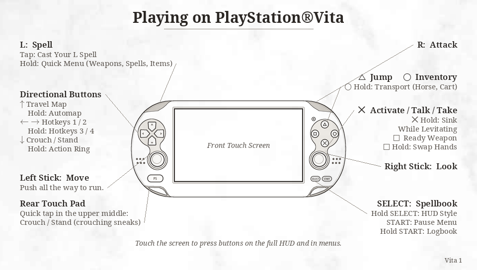
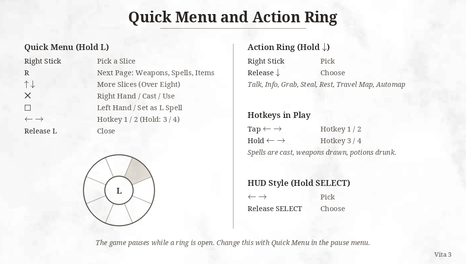

# Daggerfall Unity Vita

[English](README.md) | [Deutsch](README.de.md) | [Français](README.fr.md) | [Español](README.es.md) | Italiano | [Português](README.pt.md) | [中文](README.zh.md)

*Questo README è stato tradotto dall'inglese con l'IA. In caso di dubbi vale la [versione inglese](README.md).*

<p align="center"></p>

Questo è un port di [Daggerfall Unity](https://github.com/Interkarma/daggerfall-unity), il rifacimento open source di The Elder Scrolls II: Daggerfall, per *PS Vita*.

Il port gira sul player Unity della Vita stessa, quindi non viene emulato nulla. Ho riportato il codice di upstream su Unity 2018.2.19f1 e lo compilo con IL2CPP. Il gioco viene mostrato alla risoluzione nativa di 960x544. Quasi tutti i dati di gioco vengono convertiti su PC in pacchetti fatti per la Vita e stanno dentro il VPK, così i caricamenti sono più brevi e la memoria usata è minore.

È un'alpha, quindi aspettati dei bug. Fai una copia dei salvataggi prima di aggiornare.

## Novità

### v.0.4.0-alpha

- Nuovi comandi. Tieni premuto L per un menu rapido con armi, incantesimi e oggetti, e tieni premuto giù sulla croce direzionale per un anello delle azioni con Parla, Info, Prendi, Ruba, Riposa e le mappe. Sinistra e destra sulla croce tengono quattro scorciatoie. Vedi [Comandi](#comandi). Anche il manuale nella LiveArea mostra la nuova disposizione.
- I tasti di Dragon Rider cambiano di conseguenza: R spara un fulmine e un tocco di L dà un colpo d'ali di velocità. Vedi [Comandi di Dragon Rider](#comandi-di-dragon-rider).
- VPK in portoghese (Brasile, `DFU-pt.vpk`), tradotto da Equipe Adaga.
- Più veloce con le mod: 56 FPS di media invece di 49 sulle stesse 46 tappe, e tutte le schermate di caricamento insieme durano 85 s invece di 150 s. Vedi [Prestazioni](#prestazioni).
- Integrate 50 modifiche da Daggerfall Unity (upstream).
- Risolto un blocco che capitava lanciando gli stessi incantesimi più e più volte con molti effetti attivi.
- Dragon Rider: caricare un salvataggio fatto in volo ti rimette alla stessa altezza dal suolo.
- Gli alberi troppo lontani per essere visti non vengono più disegnati, e le foreste vanno più veloci.
- La sensibilità visuale è più alta di serie. Puoi cambiarla nel menu di pausa.

<details>
<summary>Versioni precedenti</summary>

### v.0.3.2-alpha

Cinese, due nuove mod, una nuova disposizione della croce e alcune correzioni.

- VPK in cinese (`DFU-zh.vpk`), tradotto da Czy2007.
- Due nuove mod, entrambe spente di serie: Dragon Rider (relentlessp0sitivity e Kamer) e Travel Options (Hazelnut). Attivale con il pulsante Mods nella schermata di configurazione. Sono pesanti per la Vita e possono abbassare il frame rate. Vedi [Comandi di Dragon Rider](#comandi-di-dragon-rider).
- Nel VPK cinese i messaggi di Dragon Rider e la sua missione, The Stolen Egg, sono in cinese. Le righe che il traduttore non ha coperto restano in inglese.
- I messaggi lunghi in cima allo schermo vanno a capo su una seconda riga invece di uscire da entrambi i lati.
- Destra sulla croce apre la mappa di viaggio, tenerla premuta apre la mappa automatica, e giù serve ad accovacciarsi o rialzarsi. Toccare il touchpad posteriore fa ancora accovacciare.
- Con lo zoom più vicino della mappa di viaggio, il cursore sceglie il posto a cui punta e non uno qualche riga più sotto.
- Con Dynamic Skies non c'è più il riquadro chiaro intorno alle lune, e le colline lontane all'orizzonte vengono di nuovo disegnate davanti a una luna che sorge.

### v.0.3.1-alpha

Correzioni per le versioni tradotte e un'opzione per il frame rate.

- Nuova opzione Frame rate nel menu di pausa: blocca il gioco a 30 FPS per un ritmo regolare, o lascialo libero.
- Veloce è ora la velocità CPU/GPU predefinita. Ho tolto la modalità "Veloce, senza Wi-Fi" perché il Wi-Fi poteva restare spento dopo essere usciti dal gioco. Se l'avevi scelta, ora hai Veloce.
- Esci nel menu di pausa ora riporta sempre alla schermata del titolo. Per chiudere il gioco usa il tasto PS.
- I popup tradotti non mostrano più punti interrogativi vaganti, e le righe lunghe restano sullo schermo.
- Le lettere accentate del font piccolo dell'interfaccia non stanno più sotto la riga.
- Spagnolo: immagini dei menu riscritte, un titolo spagnolo sulla mappa delle razze e correzioni a libri, domande sulla classe e qualche refuso.

### v.0.3.0-alpha

Mod integrate e quattro lingue in più.

- Francese, tedesco, italiano e spagnolo, un VPK per lingua. Menu, libri, missioni, dialoghi, la mappa, le immagini e i sottotitoli dei filmati sono tradotti.
- 21 mod integrate nel port, tutte spente finché non le attivi con il pulsante Mods nella schermata di configurazione. Vedi [Mod](#mod).
- La schermata di configurazione si apre al primo avvio, così i nuovi giocatori trovano il pulsante Mods.
- Le etichette tradotte lunghe si rimpiccioliscono per entrare nel loro riquadro.
- Corretta una striscia color acqua sulle colline lontane con World of Daggerfall - Terrain.
- La pagina delle impostazioni video non mette più Frame rate sopra il pulsante Chiudi.

### v.0.2.0-alpha

Soprattutto un gioco più fluido: le città si costruiscono un po' alla volta mentre cammini, i cittadini nascosti smettono di muoversi, le canzoni ripartono senza blocchi, meno scatti dovuti alla garbage collection e una telecamera più morbida.

### v.0.1.0-alpha

- Prima release.

</details>

## Avvertenza

Daggerfall Unity Vita è un progetto amatoriale non ufficiale. Non è affiliato né approvato da Bethesda Softworks, Sony o Unity.

Per giocare ti serve una tua copia di Daggerfall. Daggerfall per DOS è gratis su [Steam](https://store.steampowered.com/app/1812390/The_Elder_Scrolls_II_Daggerfall/).

Segnala i bug di questo port qui, non al team di Daggerfall Unity.

## Installazione

Ti serve una Vita con HENkaku o Enso e [VitaShell](https://github.com/TheOfficialFloW/VitaShell/releases) installato, più circa 2 GB liberi su `ux0:` per l'installazione. Il gioco e i suoi dati occupano circa 1,4 GB una volta cancellato il VPK.

- Scarica un VPK dalla pagina [Releases](https://github.com/GalvarinoDev/daggerfall-unity-vita/releases): `DFU-en.vpk` (inglese), `DFU-fr.vpk` (francese), `DFU-de.vpk` (tedesco), `DFU-it.vpk` (italiano), `DFU-es.vpk` (spagnolo), `DFU-pt.vpk` (portoghese) o `DFU-zh.vpk` (cinese). Installalo con VitaShell. Tutti e sette si installano come la stessa app, quindi cambiando lingua tieni salvataggi e impostazioni.
- Installa Daggerfall per DOS sul PC. Su Steam la cartella che ti serve è `DF/DAGGER/ARENA2` nella cartella di installazione del gioco.
- Copia l'intera cartella `ARENA2` sulla Vita, in modo da avere:

```
ux0:data/DaggerfallUnity/ARENA2
```

- Avvia il gioco dalla LiveArea. Il caricamento del motore può durare circa un minuto.

Il manuale originale del 1996 è incluso. Aprilo con il pulsante Manuale nella schermata LiveArea del gioco. Il VPK italiano contiene il manuale italiano completo.

Il gioco tiene salvataggi e impostazioni in `ux0:data/DaggerfallUnity/UserData`.

## Comandi

<p align="center"></p>
<p align="center"></p>
<p align="center"></p>

Una nuova partita inizia con l'HUD nascosto. Tieni premuto Select per scegliere uno stile di HUD, spostati a sinistra o a destra per sceglierne uno, poi rilascia. In una casella di testo, Triangolo riapre la tastiera di sistema.

### Menu rapido (tieni premuto L)

Tieni premuto L per aprire un anello con armi, incantesimi e oggetti. Punta una casella con la levetta destra e premi R per passare tra Armi, Incantesimi e Oggetti. Se una pagina ha più di otto elementi, su e giù sulla croce mostrano il resto. Rilascia L per chiudere.

- Armi: Croce mette l'arma nella mano destra, Quadrato nella sinistra. Premendo di nuovo lo stesso tasto la togli. La casella Cambia mano le scambia.
- Incantesimi: Croce lancia l'incantesimo. Quadrato lo rende il tuo incantesimo su L, che da quel momento lanci con un tocco di L. La casella Libro degli incantesimi apre il libro degli incantesimi.
- Oggetti: Croce usa una pozione o un oggetto magico. Quadrato su un oggetto magico mette il suo potere su L.
- Scorciatoie: in qualsiasi pagina, tocca sinistra o destra sulla croce per mettere la casella sulla scorciatoia 1 o 2, oppure tieni premuto per la 3 o la 4. In gioco, gli stessi tocchi e pressioni lunghe le usano: si lanciano incantesimi, si sguainano armi e si bevono pozioni.

Di serie il gioco va in pausa mentre l'anello è aperto. Puoi passare al tempo reale o al rallentatore con Menu rapido nel menu di pausa.

### Anello delle azioni (tieni premuto giù)

Tieni premuto giù sulla croce per un secondo anello con Parla, Info, Prendi, Ruba, Riposa, la mappa di viaggio e la mappa automatica. Punta una voce con la levetta destra e rilascia giù per sceglierla. Un tocco rapido verso il basso serve ancora ad accovacciarsi o rialzarsi.

### Comandi di Dragon Rider

Valgono solo se attivi la mod Dragon Rider (di serie è spenta). Senza, i tasti funzionano come sopra.

- Attiva il tuo drago in modalità Ruba o Prendi per montarlo, o in modalità Parla per dirgli di seguirti, aspettare o prendere una gemma. Puoi anche salire e scendere dal menu di trasporto (tieni premuto Cerchio).
- R spara un fulmine dell'elemento del tuo drago. Tocca L per un colpo d'ali di velocità e continua a toccare per mantenerla. Tenere premuto L apre ancora il menu rapido.
- Triangolo sale, Croce scende in picchiata.
- Tocca giù sulla croce per passare tra volo stazionario e volo.
- Spingi di scatto la levetta sinistra di lato per schivare. Due volte di fila fanno un avvitamento.

## Mod

La Vita non può caricare i file `.dfmod` per PC, quindi ogni mod viene convertita apposta. Attivale con il pulsante Mods nella schermata di configurazione, prima che il gioco carichi. I testi delle mod restano in inglese in tutte le lingue, tranne quelli di Dragon Rider nel VPK cinese.

Se una mod non funziona sulla Vita, molto probabilmente è un errore mio nella conversione. Segnalalo qui, non all'autore della mod.

Reimpacchetto ogni mod per la Vita e la distribuisco solo dentro le release di questo port, come mod facoltativa. Le texture passano nella tavolozza a 256 colori di Daggerfall o nei formati di texture della Vita e poi in atlanti, e modelli, mappe e altri dati vengono convertiti nei pacchetti del port. Non condivido mai i file originali delle mod. I loro autori conservano tutti i diritti sul loro lavoro e hanno dato il permesso solo per questo port (vedi Licenza).

Dragon Rider e Travel Options sono pesanti per la Vita e possono abbassare il frame rate.

<details>
<summary>Tutte le 23 mod e i loro autori</summary>

| Mod | Version | Di | Link |
|---|---|---|---|
| Basic Roads | 1.3.1 | Hazelnut | [Nexus](https://www.nexusmods.com/daggerfallunity/mods/134), [GitHub](https://github.com/ajrb/dfunity-mods) |
| Beautiful Cities of Daggerfall | 0.5.0 | carademono | [Nexus](https://www.nexusmods.com/daggerfallunity/mods/720) |
| Beautiful Villages of Daggerfall | 1.4.2 | carademono | [Nexus](https://www.nexusmods.com/daggerfallunity/mods/566), [GitHub](https://github.com/drcarademono/beautiful-villages) |
| Daggerfall Expanded Textures | 1.3.0 | Ninelan-Ruinar | [Nexus](https://www.nexusmods.com/daggerfallunity/mods/307) |
| DET Harvestable Crops | 1.0.1 | carademono, Ninelan e TheLacus | [Nexus](https://www.nexusmods.com/daggerfallunity/mods/882) |
| DIEP - Rosy's Resources | 1.1 | AlexanderSig, BenGamey974, PRAEst76 e RosyTheRascal | [Nexus](https://www.nexusmods.com/daggerfallunity/mods/1053) |
| Distant Terrain of the World of Daggerfall | 3.69 | MaoDeVaca, basato su [Distant Terrain](https://www.nexusmods.com/daggerfallunity/mods/128) di Nystul | [Nexus](https://www.nexusmods.com/daggerfallunity/mods/1284) |
| Dragon Rider | 1.1 | relentlessp0sitivity e Kamer (SquidKamer) | [Nexus](https://www.nexusmods.com/daggerfallunity/mods/1334) |
| Dynamic Skies | 2.3.4 | BadLuckBurt e carademono | [Nexus](https://www.nexusmods.com/daggerfallunity/mods/376), [GitHub](https://github.com/drcarademono/dynamic-skies) |
| Finding My Religion | 1.23 | Cliffworms, con statue di King of Worms | [Nexus](https://www.nexusmods.com/daggerfallunity/mods/344) |
| Fixed Desert Architecture | 1.3.7 | Cliffworms | [Nexus](https://www.nexusmods.com/daggerfallunity/mods/333) |
| Fixed Dungeon Exteriors | 1.4.4 | Cliffworms | [Nexus](https://www.nexusmods.com/daggerfallunity/mods/225) |
| Low Poly Trees | 5 | Kamer (SquidKamer) | [Nexus](https://www.nexusmods.com/daggerfallunity/mods/380) |
| Redguards of Hammerfell | 0.6 | WilhelmBlack | [Nexus](https://www.nexusmods.com/daggerfallunity/mods/666) |
| RMB Resource Pack | 0.3.0 | molti creatori, caricato da Cliffworms e mantenuto da carademono | [Nexus](https://www.nexusmods.com/daggerfallunity/mods/528), [GitHub](https://github.com/drcarademono/rmb-resource-pack) |
| Travel Options | 1.11 | Hazelnut | [Nexus](https://www.nexusmods.com/daggerfallunity/mods/122), [GitHub](https://github.com/ajrb/dfunity-mods) |
| Vanilla Friendly Loading Screens | 1.1 | WilhelmBlack | [Nexus](https://www.nexusmods.com/daggerfallunity/mods/838) |
| Windmills of Daggerfall | 2.2 | Kamer (SquidKamer) | [Nexus](https://www.nexusmods.com/daggerfallunity/mods/33) |
| World of Daggerfall | 0.4.0 | World of Daggerfall Team: carademono, Cliffworms, JayH e Kamer, con Location Loader di KABoissonneault e UncannyValley | [Nexus](https://www.nexusmods.com/daggerfallunity/mods/249), [GitHub](https://github.com/drcarademono/world-of-daggerfall), [Location Loader](https://github.com/KABoissonneault/DFU-LocationLoader) |
| World of Daggerfall - Biomes | 0.4.0 | carademono e KABoissonneault | [Nexus](https://www.nexusmods.com/daggerfallunity/mods/249), [GitHub](https://github.com/drcarademono/wod-biomes) |
| World of Daggerfall - Terrain | 1.5.0 | carademono, Freak2121, monobelisk e Ninelan | [Nexus](https://www.nexusmods.com/daggerfallunity/mods/249), [GitHub](https://github.com/drcarademono/wod-terrain) |

Ho chiesto il permesso all'autore o al responsabile di ogni mod. Se un autore non era raggiungibile ma la mod è sotto licenza MIT, è inclusa lo stesso. Se hai creato una di queste mod e preferisci che venga tolta dal port, apri una issue e la toglierò.

Due sono nuove per la Vita: Old Masters of Tamriel, una serie di dipinti di pubblico dominio da Wikimedia Commons, e Snowless, che d'inverno tiene verdi paludi, giungle e boschi, con la pioggia al posto della neve.

World of Daggerfall - Terrain e Distant Terrain sono quelle che costano più frame rate.

</details>

## Impostazioni della luce

<details>
<summary>Luce dei dungeon, torce e colore del fuoco</summary>

Si trovano nell'elenco a discesa del menu di pausa. Ogni clic porta la voce al valore successivo, e la modifica vale subito.

| Opzione | Valori | Predefinito |
|---|---|---|
| Luce dei dungeon | 30%, 50%, 70%, 100% | 100% |
| Luce del fuoco (torce e lanterne) | 50%, 75%, 100%, 150%, 200% | 100% |
| Colore del fuoco | Bianco, Leggermente caldo, Caldo, Molto caldo | Bianco |
| Portata della torcia | 6 m, 9 m, 12 m | 6 m |

I valori predefiniti riproducono l'aspetto di Daggerfall Unity su PC.

</details>

## Prestazioni

<details>
<summary>Frame rate e tempi di caricamento</summary>

Misurati su una PCH-1000 con la 0.4.0. Un bot ha visitato di corsa le stesse 46 tappe: un dungeon, la natura selvaggia, e Daggerfall, Wayrest e Sentinel (strade a mezzogiorno e di notte, taverne, negozi e palazzi). Per ogni tappa conta il migliore di due giri.

| | Senza mod | Tutte le mod |
|---|---|---|
| Media | 59 FPS | 56 FPS |
| Taverne, negozi, palazzi, dungeon | 60 FPS | 60 FPS |
| Strade di città | 52-60 FPS | 31-60 FPS |
| Natura selvaggia | 46-60 FPS | 51-60 FPS |
| Tutte le schermate di caricamento sommate | 81 s | 85 s |
| Caricamento singolo più lungo | 11 s | 11 s |

Per confronto, la 0.3.2 andava in media a 58 FPS senza mod e 49 FPS con tutte, e le sue schermate di caricamento sommavano 100 s e 150 s.

Nessun giro è andato in crash. L'impostazione di velocità predefinita porta la CPU a 444 MHz, alza la frequenza della GPU e limita la luminosità dello schermo. Puoi cambiarla con Velocità CPU/GPU nel menu di pausa.

</details>

## Problemi noti

- Il castello di Daggerfall ha ancora brevi scatti ad alcune porte.
- Il browser web e il PlayStation Store non possono funzionare insieme al gioco, perché usa la modalità di memoria extra della Vita.
- I video sostitutivi, il Post Processing e i font TextMeshPro di Daggerfall Unity per PC non sono disponibili. I filmati originali si vedono ancora.

## Compilarlo da soli

Le istruzioni sono in inglese nel [README inglese](README.md#building-it-yourself).

## Ringraziamenti

- La mia ragazza. Ho iniziato il port perché lei voleva prendere in prestito la mia Vita quando andava a trovare la sua famiglia per il Ringraziamento di quest'anno.
- [Interkarma](https://github.com/Interkarma), Daggerfall Workshop e tutti quelli che hanno contribuito a [Daggerfall Unity](https://github.com/Interkarma/daggerfall-unity).
- Bethesda Softworks per The Elder Scrolls II: Daggerfall.

### Traduzioni

- Cinese: [Czy2007](https://www.nexusmods.com/daggerfallunity/users/230972787), [Chinese translation](https://www.nexusmods.com/daggerfallunity/mods/1418)
- Francese: [Daneel53](https://www.nexusmods.com/daggerfallunity/users/6838829) ([GitHub](https://github.com/Daneel53)) e Pango, [French Daggerfall](https://www.nexusmods.com/daggerfallunity/mods/456)
- Tedesco: [Deepfighter](https://github.com/deepfighter) e Numenorean, [Daggerfall Deutsch](https://www.nexusmods.com/daggerfallunity/mods/826)
- Italiano: [XSpettro101X](https://www.nexusmods.com/profile/XSpettro101X?gameId=2927), con immagini e filmati di [Rotary00](https://www.nexusmods.com/profile/Rotary00), [Traduzione Italiana](https://www.nexusmods.com/daggerfallunity/mods/1182)
- Portoghese (Brasile): Equipe Adaga (Geavy, NecroBardo e Darkuby), caricato da [Antony827](https://www.nexusmods.com/profile/Antony827?gameId=2927), [Tradução de Daggerfall Unity](https://www.nexusmods.com/daggerfallunity/mods/565)
- Spagnolo: [raulpuro](https://forums.dfworkshop.net/memberlist.php?mode=viewprofile&u=1633), con alcune righe della [traduzione spagnola](https://www.nexusmods.com/daggerfallunity/mods/1251) di [NarrodRecandriall](https://github.com/Narrod-Dev)

Aggiungo volentieri altre lingue se i traduttori sono d'accordo. Se hai fatto una traduzione di Daggerfall Unity e vorresti vederla sulla Vita, apri una issue qui o scrivimi sul Discord Lysandus' Tomb: DFU Fan Server.

### Autori delle mod

Questi autori hanno permesso alle loro mod di arrivare sulla Vita. La pagina di ogni mod è collegata in [Mod](#mod).

[AlexanderSig](https://www.nexusmods.com/profile/alexandersig?gameId=2927), [BadLuckBurt](https://github.com/BadLuckBurt), [BenGamey974](https://en.uesp.net/wiki/User:Bengamey_974), [carademono](https://www.nexusmods.com/daggerfallunity/users/107697598) ([GitHub](https://github.com/drcarademono)), [Cliffworms](https://www.nexusmods.com/daggerfallunity/users/13821) ([GitHub](https://github.com/Cliffworms)), [Freak2121](https://www.nexusmods.com/daggerfallunity/users/1626563) ([GitHub](https://github.com/Freak2121)), [Hazelnut](https://github.com/ajrb), [JayH](https://github.com/JayH2971), [KABoissonneault](https://www.nexusmods.com/daggerfallunity/users/5856175) ([GitHub](https://github.com/KABoissonneault)), [Kamer (SquidKamer)](https://github.com/SquidKamer), [King of Worms](https://www.nexusmods.com/profile/KingOfWormsDFU?gameId=2927), [MaoDeVaca](https://www.nexusmods.com/daggerfallunity/users/98208923), [monobelisk](https://www.nexusmods.com/daggerfallunity/users/14045140) ([GitHub](https://github.com/monobelisk)), [Ninelan-Ruinar](https://www.nexusmods.com/daggerfallunity/users/39888770), [Nystul](https://www.nexusmods.com/daggerfallunity/users/91388288) ([GitHub](https://github.com/Nystul-the-Magician)), [PRAEst76](https://www.nexusmods.com/daggerfallunity/users/56241), [RosyTheRascal](https://www.nexusmods.com/daggerfallunity/users/50021166), [TheLacus](https://github.com/TheLacus), [UncannyValley](https://forums.dfworkshop.net/memberlist.php?mode=viewprofile&u=72) e [WilhelmBlack](https://www.nexusmods.com/profile/WilhelmBlack?gameId=2927).

### Aiuto con il port

- [AJ](https://github.com/AJ170) e il server PS Vita Forever.
- [Vwing](https://github.com/Vwing) per le idee prese dal port Android di Daggerfall Unity che ha realizzato.
- [Kenney](https://www.kenney.nl) per il pacchetto [Input Prompts](https://kenney.nl/assets/input-prompts) (CC0). Le icone dei tasti nel menu rapido si basano su quello.
- [shoui520](https://github.com/shoui520) per [vita-agent-use](https://github.com/shoui520/vita-agent-use). L'ho usato per installare build di prova sulla mia Vita e farci girare un bot di notte, perché il gioco è grande più o meno come il Regno Unito e non posso visitare ogni posto da solo. Così sono venuti fuori tanti crash e punti lenti.

## Licenza

Il codice del port è MIT, come Daggerfall Unity (upstream). Vedi [LICENSE](./LICENSE).

La licenza copre solo il codice. Non copre né i dati del gioco né le mod, convertite o no, e nessuno dei due è in questo repository. Le mod appartengono ai loro autori, che hanno dato il permesso solo per questo port, quindi chi vuole usarle in un fork o altrove deve prima chiederlo agli autori.
