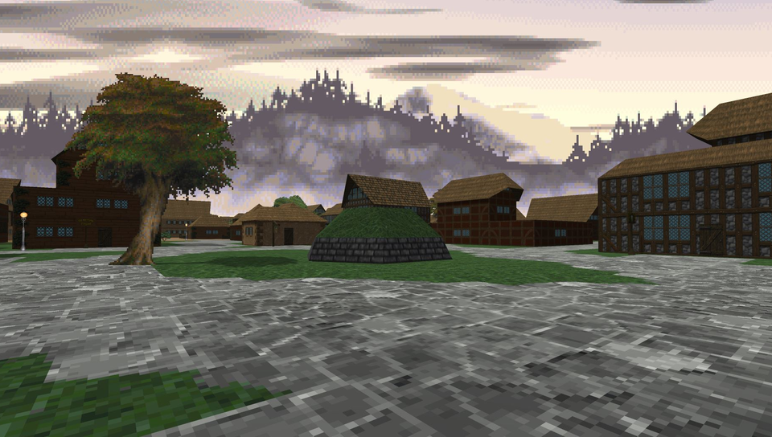
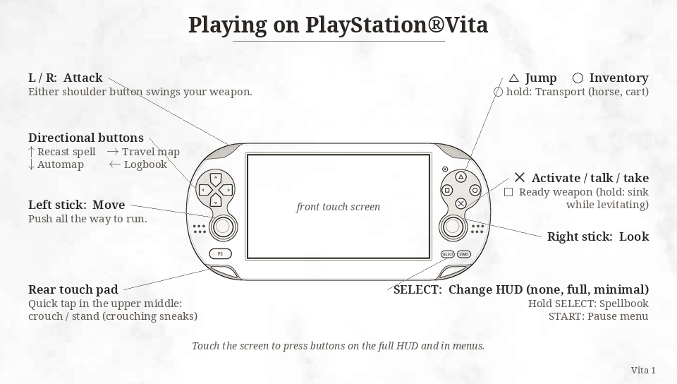
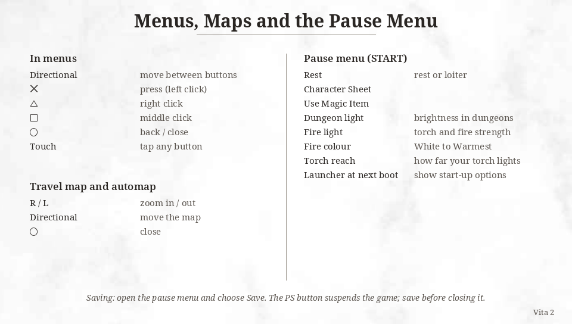

# Daggerfall Unity Vita

<p align="center"></p>

This is a port of [Daggerfall Unity](https://github.com/Interkarma/daggerfall-unity), the open source recreation of The Elder Scrolls II: Daggerfall, for the *PS Vita*.

The port runs on the Vita's own Unity player, so nothing is emulated. I backported upstream's code to Unity 2018.2.19f1 and build it with IL2CPP, and the game renders at the native 960x544. Most game data is baked on a PC into packs made for the Vita and ships inside the VPK, which keeps load times and memory use down.

This is an alpha, so expect bugs. Back up your saves before updating.

## Changelog

### v.0.3.0-alpha

Built-in mods and four more languages.

- German, French, Spanish and Italian, one VPK per language. Menus, books, quests, dialogue, the map, images and movie subtitles are translated.
- 21 mods built into the port, all off until you turn them on from the Mods button on the setup screen. See [Mods](#mods).
- The setup screen opens at first launch so new players can find the Mods button.
- Long translated labels shrink to fit their box.
- Fixed a band of water colour on far hillsides with World of Daggerfall - Terrain on.
- The Video settings page no longer puts Frame Rate on top of the Close button.

### v.0.2.0-alpha

Mostly smoother play: towns build a little at a time while you walk, hidden civilians stop moving, songs loop without a freeze, fewer garbage collection hitches, and a smoother camera.

### v.0.1.0-alpha

- Initial release.

## Disclaimer

Daggerfall Unity Vita is an unofficial fan project. It is not affiliated with or endorsed by Bethesda Softworks, Sony or Unity.

You need your own copy of Daggerfall to play. DOS Daggerfall is free on [Steam](https://store.steampowered.com/app/1812390/The_Elder_Scrolls_II_Daggerfall/).

Please report bugs in this port here, not to the Daggerfall Unity team.

## Setup for players

You need a Vita running HENkaku or Enso with [VitaShell](https://github.com/TheOfficialFloW/VitaShell/releases) installed, and about 2 GB free on `ux0:` for the install. The game and its data take about 1.4 GB once you delete the VPK.

- Download one VPK from the [Releases](https://github.com/GalvarinoDev/daggerfall-unity-vita/releases) page: `DFU-en.vpk` (English), `DFU-de.vpk` (German), `DFU-fr.vpk` (French), `DFU-es.vpk` (Spanish) or `DFU-it.vpk` (Italian). Install it with VitaShell. All five install as the same app, so switching languages keeps your saves and settings.
- Install DOS Daggerfall on your PC. On Steam, the folder you need is `DF/DAGGER/ARENA2` inside the game's install folder.
- Copy the whole `ARENA2` folder to your Vita, so that you end up with:

```
ux0:data/DaggerfallUnity/ARENA2
```

- Launch the game from the LiveArea. The engine load can take about a minute.

The original 1996 manual is included. Open it with the Manual button on the game's LiveArea screen. The Italian VPK has the full Italian manual.

The game keeps saves and settings in `ux0:data/DaggerfallUnity/UserData`.

## Controls

<p align="center"></p>
<p align="center"></p>

A new game starts with the HUD hidden, so tap Select to bring it up. In a text box, Triangle reopens the system keyboard.

## Mods

The Vita can't load PC `.dfmod` files, so each mod was rebuilt for it. Turn them on from the Mods button on the setup screen, before the game loads. Mod text stays in English in every language.

| Mod | Version | By | Links |
|---|---|---|---|
| Dynamic Skies | 2.3.4 | BadLuckBurt and carademono | [Nexus](https://www.nexusmods.com/daggerfallunity/mods/376), [GitHub](https://github.com/drcarademono/dynamic-skies) |
| Basic Roads | 1.3.1 | Hazelnut | [Nexus](https://www.nexusmods.com/daggerfallunity/mods/134), [GitHub](https://github.com/ajrb/dfunity-mods) |
| Low Poly Trees | 5 | Kamer (SquidKamer) | [Nexus](https://www.nexusmods.com/daggerfallunity/mods/380) |
| Windmills of Daggerfall | 2.2 | Kamer (SquidKamer) | [Nexus](https://www.nexusmods.com/daggerfallunity/mods/33) |
| Beautiful Cities of Daggerfall | 0.5.0 | carademono | [Nexus](https://www.nexusmods.com/daggerfallunity/mods/720) |
| Beautiful Villages of Daggerfall | 1.4.2 | carademono | [Nexus](https://www.nexusmods.com/daggerfallunity/mods/566), [GitHub](https://github.com/drcarademono/beautiful-villages) |
| Finding My Religion | 1.23 | Cliffworms, with statues by King of Worms | [Nexus](https://www.nexusmods.com/daggerfallunity/mods/344) |
| Fixed Desert Architecture | 1.3.7 | Cliffworms | [Nexus](https://www.nexusmods.com/daggerfallunity/mods/333) |
| Fixed Dungeon Exteriors | 1.4.4 | Cliffworms | [Nexus](https://www.nexusmods.com/daggerfallunity/mods/225) |
| Daggerfall Expanded Textures | 1.3.0 | Ninelan-Ruinar | [Nexus](https://www.nexusmods.com/daggerfallunity/mods/307) |
| RMB Resource Pack | 0.3.0 | many asset creators, uploaded by Cliffworms and maintained by carademono | [Nexus](https://www.nexusmods.com/daggerfallunity/mods/528), [GitHub](https://github.com/drcarademono/rmb-resource-pack) |
| DIEP - Rosy's Resources | 1.1 | RosyTheRascal, PRAEst76, BenGamey974 and AlexanderSig | [Nexus](https://www.nexusmods.com/daggerfallunity/mods/1053) |
| DET Harvestable Crops | 1.0.1 | TheLacus, Ninelan and carademono | [Nexus](https://www.nexusmods.com/daggerfallunity/mods/882) |
| Redguards of Hammerfell | 0.6 | WilhelmBlack | [Nexus](https://www.nexusmods.com/daggerfallunity/mods/666) |
| World of Daggerfall | 0.4.0 | World of Daggerfall Team: Kamer, carademono, Cliffworms and JayH, with Location Loader by UncannyValley and KABoissonneault | [Nexus](https://www.nexusmods.com/daggerfallunity/mods/249), [GitHub](https://github.com/drcarademono/world-of-daggerfall), [Location Loader](https://github.com/KABoissonneault/DFU-LocationLoader) |
| World of Daggerfall - Terrain | 1.5.0 | monobelisk, Freak2121, carademono and Ninelan | [Nexus](https://www.nexusmods.com/daggerfallunity/mods/249), [GitHub](https://github.com/drcarademono/wod-terrain) |
| World of Daggerfall - Biomes | 0.4.0 | carademono and Kab the Bird Ranger | [Nexus](https://www.nexusmods.com/daggerfallunity/mods/249), [GitHub](https://github.com/drcarademono/wod-biomes) |
| Distant Terrain of the World of Daggerfall | 3.69 | MaoDeVaca, based on Nystul's [Distant Terrain](https://www.nexusmods.com/daggerfallunity/mods/128) | [Nexus](https://www.nexusmods.com/daggerfallunity/mods/1284) |
| Vanilla Friendly Loading Screens |  | WilhelmBlack |  |

Two are new for the Vita: Old Masters of Tamriel, a set of public-domain paintings from Wikimedia Commons, and Snowless, which keeps swamps, jungles and woodlands green in winter with rain instead of snow.

World of Daggerfall - Terrain and Distant Terrain cost the most frame rate.

## Lighting

You can adjust the lighting from the dropdown list in the pause menu. Each entry moves to its next value when you click it, and the changes apply right away.

| Option | Values | Default |
|---|---|---|
| Dungeon light | 30%, 50%, 70%, 100% | 100% |
| Fire light (torches and lanterns) | 50%, 75%, 100%, 150%, 200% | 100% |
| Fire colour | White, Slightly warm, Warm, Warmest | White |
| Torch reach | 6 m, 9 m, 12 m | 6 m |

The defaults match the look of Daggerfall Unity on PC.

## Performance

I measured these on one PCH-1000 with 0.3.0, with a bot visiting the same 46 stops at running speed: a dungeon, the wilderness, and Daggerfall, Wayrest and Sentinel (streets at noon and at night, taverns, shops and palaces).

| | No mods | All mods |
|---|---|---|
| Average | 58 FPS | 48 FPS |
| Taverns, shops, dungeon | 57-60 FPS | 59-60 FPS |
| City streets | 47-60 FPS | 33-52 FPS |
| Wilderness | 44-60 FPS | 44-47 FPS |
| Total loading time | 106 s | 151 s |

Neither run crashed. The default speed setting raises the CPU to 444 MHz and the GPU clock, and limits screen brightness. You can change this with CPU/GPU speed in the pause menu.

## Known issues

- Daggerfall castle still has short hitches at some doorways.
- The web browser and PlayStation Store can't run alongside the game, because it uses the Vita's extra memory mode.
- Replacement videos, Post Processing and TextMeshPro fonts from PC Daggerfall Unity are not available. The original cutscenes still play.

## Building it yourself

The Vita's Unity support is not publicly available, so you need your own licensed copy of Unity 2018.2.19f1 with PS Vita build support.

The scripts in `vita/` are written for a Linux machine running the editor under Proton, and you will need to adjust their paths for your setup. `vita/unity2017.sh` expects a machine-specific `vita/local.env`, which is not in the repository. Baked data, rendered music and some images are not in the repository either, so a fresh clone has to generate them. I haven't tested that yet.

With the Unity editor closed, run from the repository root:

```bash
vita/apply_settings.sh

# Bake game data. Set ARENA2 if your copy isn't the default Steam one.
export ARENA2=/path/to/ARENA2
for s in textures texfiles skies models blocks weapons maps mapdata blockdata images fonts strings books quests careers biogs locbooks; do
  vita/tools/bake_$s.sh
done
vita/tools/faction_bake.sh
vita/tools/namegen_bake.sh

# Render the music with Daggerfall Unity's own synth.
vita/tools/render_music.sh

# Build and pack vita/build/DFU.vpk.
vita/build.sh && python3 vita/tools/pack_vpk.py
```

Vita-only changes to upstream's files sit behind `#if UNITY_PSP2` with upstream's original lines kept beside them, so upstream merges stay readable. `vita/tools/guard_diff.py` helps keep them that way. The built-in mods compile in with `VITA_MODS` (`Assets/csc.rsp`).

`vita/bootmusic` is an optional taiHEN plugin that plays the title theme during the engine load. `dfu-vita-converters` holds PC scripts that convert mod data for the port.

## Credits

- [Interkarma](https://github.com/Interkarma), Daggerfall Workshop and all the Daggerfall Unity contributors for [Daggerfall Unity](https://github.com/Interkarma/daggerfall-unity).
- Bethesda Softworks for The Elder Scrolls II: Daggerfall.
- Translations: Deepfighter and Numenorean (German, Daggerfall Deutsch), Daneel53 and Pango (French), raulpuro with some lines from NarrodRecandriall (Spanish), XSpettro101X with images and movies by Rotary00 (Italian).
- The mod authors listed under [Mods](#mods), who let their work come to the Vita.
- [Vwing](https://github.com/Vwing) for ideas from their Android port of Daggerfall Unity.
- [AJ](https://github.com/AJ170) and the PS Vita Forever server for their help with the project.

## License

MIT, the same as upstream Daggerfall Unity. See [LICENSE](./LICENSE). The game's data is not covered by this license and is not included in this repository.
