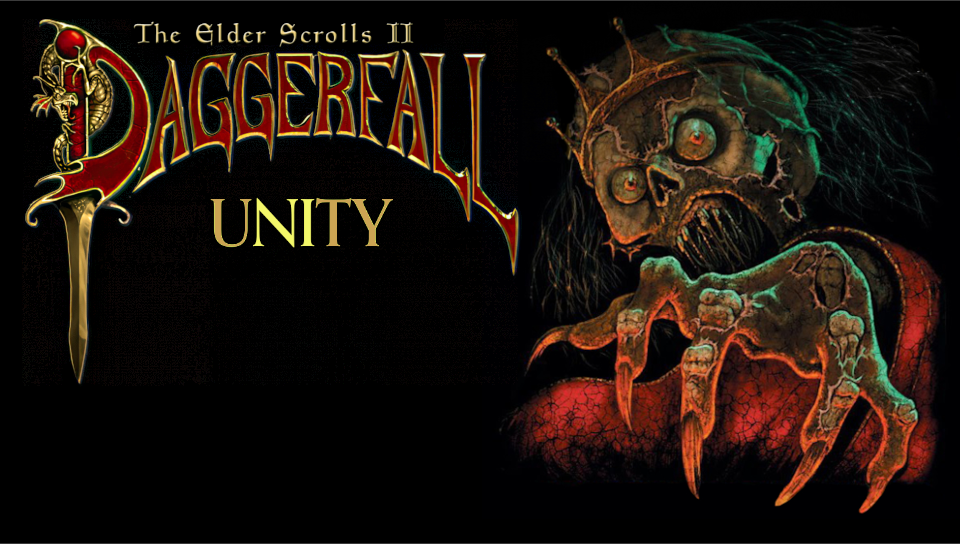

# Daggerfall Unity Vita

<p align="center"></p>

This is a port of [Daggerfall Unity](https://github.com/Interkarma/daggerfall-unity), the open source recreation of The Elder Scrolls II: Daggerfall, for the *PS Vita*.

The port runs on the Vita's own Unity player, so nothing is emulated. I backported upstream's code to Unity 2018.2.19f1 and build it with IL2CPP, and the game renders at the native 960x544. Most game data is baked on a PC into packs made for the Vita and ships inside the VPK, which keeps load times and memory use down.

This is an alpha, so expect bugs. Back up your saves before updating.

## Changelog

### v.0.3.2-alpha

Chinese, two new mods, a new D-pad layout and some fixes.

- Chinese VPK (`DFU-zh.vpk`), translated by Czy2007.
- Two new mods, both off by default: Dragon Rider (relentlessp0sitivity and Kamer) and Travel Options (Hazelnut). Turn them on from the Mods button on the setup screen. They're heavy on the Vita and can lower the frame rate. See [Dragon Rider controls](#dragon-rider-controls).
- In the Chinese VPK, Dragon Rider's messages and its quest, The Stolen Egg, are in Chinese. Lines the translator didn't cover stay in English.
- Long messages at the top of the screen wrap onto a second line instead of running off both edges.
- D-pad Right opens the travel map, holding it opens the automap, and Down crouches or stands up. Tapping the rear touch pad still crouches too.
- At the closest travel map zoom, the cursor picks the place it points at, not one a few rows below.
- With Dynamic Skies on, the pale box around the moons is gone, and distant hills at the horizon are drawn in front of a rising moon again.

<details>
<summary>Older versions</summary>

### v.0.3.1-alpha

Fixes for the translated versions, plus a frame rate option.

- New Frame Rate option in the pause menu: lock the game to 30 FPS for even pacing, or leave it unlocked.
- Fast is now the default CPU/GPU speed. I removed the "Fast, no Wi-Fi" mode because Wi-Fi could stay off after you left the game. If you had it selected, you now get Fast.
- Exit in the pause menu now always takes you back to the title screen. To close the game, use the PS button.
- Translated popups no longer show stray question marks, and long lines stay on screen.
- Accented letters in the small UI font no longer sit below the line.
- Spanish: re-lettered menu images, a Spanish title on the race map, and fixes to books, class questions and a few typos.

### v.0.3.0-alpha

Built-in mods and four more languages.

- French, German, Italian and Spanish, one VPK per language. Menus, books, quests, dialogue, the map, images and movie subtitles are translated.
- 21 mods built into the port, all off until you turn them on from the Mods button on the setup screen. See [Mods](#mods).
- The setup screen opens at first launch so new players can find the Mods button.
- Long translated labels shrink to fit their box.
- Fixed a band of water colour on far hillsides with World of Daggerfall - Terrain on.
- The Video settings page no longer puts Frame Rate on top of the Close button.

### v.0.2.0-alpha

Mostly smoother play: towns build a little at a time while you walk, hidden civilians stop moving, songs loop without a freeze, fewer garbage collection hitches, and a smoother camera.

### v.0.1.0-alpha

- Initial release.

</details>

## Disclaimer

Daggerfall Unity Vita is an unofficial fan project. It is not affiliated with or endorsed by Bethesda Softworks, Sony or Unity.

You need your own copy of Daggerfall to play. DOS Daggerfall is free on [Steam](https://store.steampowered.com/app/1812390/The_Elder_Scrolls_II_Daggerfall/).

Please report bugs in this port here, not to the Daggerfall Unity team.

## Setup for players

You need a Vita running HENkaku or Enso with [VitaShell](https://github.com/TheOfficialFloW/VitaShell/releases) installed, and about 2 GB free on `ux0:` for the install. The game and its data take about 1.4 GB once you delete the VPK.

- Download one VPK from the [Releases](https://github.com/GalvarinoDev/daggerfall-unity-vita/releases) page: `DFU-en.vpk` (English), `DFU-fr.vpk` (French), `DFU-de.vpk` (German), `DFU-it.vpk` (Italian), `DFU-es.vpk` (Spanish) or `DFU-zh.vpk` (Chinese). Install it with VitaShell. All six install as the same app, so switching languages keeps your saves and settings.
- Install DOS Daggerfall on your PC. On Steam, the folder you need is `DF/DAGGER/ARENA2` inside the game's install folder.
- Copy the whole `ARENA2` folder to your Vita, so that you end up with:

```
ux0:data/DaggerfallUnity/ARENA2
```

- Launch the game from the LiveArea. The engine load can take about a minute.

The original 1996 manual is included. Open it with the Manual button on the game's LiveArea screen. The Italian VPK has the full Italian manual.

The game keeps saves and settings in `ux0:data/DaggerfallUnity/UserData`.

## Controls

<p align="center"></p>
<p align="center"></p>

A new game starts with the HUD hidden, so tap Select to bring it up. In a text box, Triangle reopens the system keyboard.

### Dragon Rider controls

- Activate your dragon in Steal or Grab mode to mount it, or in Talk mode to tell it to follow, wait or take a gem. You can also mount and dismount from the transport menu (hold Circle).
- Triangle climbs and Cross dives.
- Hold Square to switch between hovering and flying. Tap Square to ready your weapon.
- L shoots a bolt of your dragon's element, and holding R boosts.
- Flick the left stick hard to one side to dodge. Flick it twice for a barrel roll.

## Mods

The Vita can't load PC `.dfmod` files, so each mod is converted for it. Turn them on from the Mods button on the setup screen, before the game loads. Mod text stays in English in every language, except Dragon Rider's in the Chinese VPK.

If a mod breaks on the Vita, it's most likely a mistake I made while converting it. Please report it here, not to the mod's author.

Dragon Rider and Travel Options are heavy on the Vita and can lower the frame rate.

<details>
<summary>All 23 mods and their authors</summary>

| Mod | Version | By | Links |
|---|---|---|---|
| Basic Roads | 1.3.1 | Hazelnut | [Nexus](https://www.nexusmods.com/daggerfallunity/mods/134), [GitHub](https://github.com/ajrb/dfunity-mods) |
| Beautiful Cities of Daggerfall | 0.5.0 | carademono | [Nexus](https://www.nexusmods.com/daggerfallunity/mods/720) |
| Beautiful Villages of Daggerfall | 1.4.2 | carademono | [Nexus](https://www.nexusmods.com/daggerfallunity/mods/566), [GitHub](https://github.com/drcarademono/beautiful-villages) |
| Daggerfall Expanded Textures | 1.3.0 | Ninelan-Ruinar | [Nexus](https://www.nexusmods.com/daggerfallunity/mods/307) |
| DET Harvestable Crops | 1.0.1 | carademono, Ninelan and TheLacus | [Nexus](https://www.nexusmods.com/daggerfallunity/mods/882) |
| DIEP - Rosy's Resources | 1.1 | AlexanderSig, BenGamey974, PRAEst76 and RosyTheRascal | [Nexus](https://www.nexusmods.com/daggerfallunity/mods/1053) |
| Distant Terrain of the World of Daggerfall | 3.69 | MaoDeVaca, based on Nystul's [Distant Terrain](https://www.nexusmods.com/daggerfallunity/mods/128) | [Nexus](https://www.nexusmods.com/daggerfallunity/mods/1284) |
| Dragon Rider | 1.1 | relentlessp0sitivity and Kamer (SquidKamer) | [Nexus](https://www.nexusmods.com/daggerfallunity/mods/1334) |
| Dynamic Skies | 2.3.4 | BadLuckBurt and carademono | [Nexus](https://www.nexusmods.com/daggerfallunity/mods/376), [GitHub](https://github.com/drcarademono/dynamic-skies) |
| Finding My Religion | 1.23 | Cliffworms, with statues by King of Worms | [Nexus](https://www.nexusmods.com/daggerfallunity/mods/344) |
| Fixed Desert Architecture | 1.3.7 | Cliffworms | [Nexus](https://www.nexusmods.com/daggerfallunity/mods/333) |
| Fixed Dungeon Exteriors | 1.4.4 | Cliffworms | [Nexus](https://www.nexusmods.com/daggerfallunity/mods/225) |
| Low Poly Trees | 5 | Kamer (SquidKamer) | [Nexus](https://www.nexusmods.com/daggerfallunity/mods/380) |
| Redguards of Hammerfell | 0.6 | WilhelmBlack | [Nexus](https://www.nexusmods.com/daggerfallunity/mods/666) |
| RMB Resource Pack | 0.3.0 | many asset creators, uploaded by Cliffworms and maintained by carademono | [Nexus](https://www.nexusmods.com/daggerfallunity/mods/528), [GitHub](https://github.com/drcarademono/rmb-resource-pack) |
| Travel Options | 1.11 | Hazelnut | [Nexus](https://www.nexusmods.com/daggerfallunity/mods/122), [GitHub](https://github.com/ajrb/dfunity-mods) |
| Vanilla Friendly Loading Screens | 1.1 | WilhelmBlack | [Nexus](https://www.nexusmods.com/daggerfallunity/mods/838) |
| Windmills of Daggerfall | 2.2 | Kamer (SquidKamer) | [Nexus](https://www.nexusmods.com/daggerfallunity/mods/33) |
| World of Daggerfall | 0.4.0 | World of Daggerfall Team: carademono, Cliffworms, JayH and Kamer, with Location Loader by KABoissonneault and UncannyValley | [Nexus](https://www.nexusmods.com/daggerfallunity/mods/249), [GitHub](https://github.com/drcarademono/world-of-daggerfall), [Location Loader](https://github.com/KABoissonneault/DFU-LocationLoader) |
| World of Daggerfall - Biomes | 0.4.0 | carademono and KABoissonneault | [Nexus](https://www.nexusmods.com/daggerfallunity/mods/249), [GitHub](https://github.com/drcarademono/wod-biomes) |
| World of Daggerfall - Terrain | 1.5.0 | carademono, Freak2121, monobelisk and Ninelan | [Nexus](https://www.nexusmods.com/daggerfallunity/mods/249), [GitHub](https://github.com/drcarademono/wod-terrain) |

Each mod's author or project lead was asked for permission. Where an author couldn't be reached but the mod is under the MIT license, it's still included. If you made one of these mods and would prefer it taken out of the port, open an issue and I'll remove it.

Two are new for the Vita: Old Masters of Tamriel, a set of public-domain paintings from Wikimedia Commons, and Snowless, which keeps swamps, jungles and woodlands green in winter with rain instead of snow.

World of Daggerfall - Terrain and Distant Terrain cost the most frame rate.

</details>

## Light settings

<details>
<summary>Dungeon light, torches and fire colour</summary>

These are in the dropdown list in the pause menu. Each entry moves to its next value when you click it, and the changes apply right away.

| Option | Values | Default |
|---|---|---|
| Dungeon light | 30%, 50%, 70%, 100% | 100% |
| Fire light (torches and lanterns) | 50%, 75%, 100%, 150%, 200% | 100% |
| Fire colour | White, Slightly warm, Warm, Warmest | White |
| Torch reach | 6 m, 9 m, 12 m | 6 m |

The defaults match the look of Daggerfall Unity on PC.

</details>

## Performance

<details>
<summary>Frame rates and load times</summary>

I measured these on one PCH-1000 with 0.3.0, with a bot visiting the same 46 stops at running speed: a dungeon, the wilderness, and Daggerfall, Wayrest and Sentinel (streets at noon and at night, taverns, shops and palaces).

| | No mods | All mods |
|---|---|---|
| Average | 58 FPS | 48 FPS |
| Taverns, shops, dungeon | 57-60 FPS | 59-60 FPS |
| City streets | 47-60 FPS | 33-52 FPS |
| Wilderness | 44-60 FPS | 44-47 FPS |
| All loading screens added up | 106 s | 151 s |
| Longest single load | 14 s | 19 s |

Neither run crashed. The default speed setting raises the CPU to 444 MHz and the GPU clock, and limits screen brightness. You can change this with CPU/GPU speed in the pause menu.

</details>

## Known issues

- Daggerfall castle still has short hitches at some doorways.
- The web browser and PlayStation Store can't run alongside the game, because it uses the Vita's extra memory mode.
- Replacement videos, Post Processing and TextMeshPro fonts from PC Daggerfall Unity are not available. The original cutscenes still play.

## Building it yourself

<details>
<summary>How to build it</summary>

The Vita's Unity support is not publicly available, so you need your own licensed copy of Unity 2018.2.19f1 with PS Vita build support.

The scripts in `vita/` are written for a Linux machine running the editor under Proton, and you will need to adjust their paths for your setup. `vita/unity2017.sh` expects a machine-specific `vita/local.env`, which is not in the repository. Baked data, rendered music and some images are not in the repository either, so a fresh clone has to generate them. I haven't tested that yet.

With the Unity editor closed, run from the repository root:

```bash
vita/apply_settings.sh

# Bake game data. Set ARENA2 if your copy isn't the default Steam one.
export ARENA2=/path/to/ARENA2
for s in textures texfiles skies models blocks weapons maps mapdata blockdata images fonts strings books quests careers biogs locbooks; do
  vita/tools/bake_$s.sh
done
vita/tools/faction_bake.sh
vita/tools/namegen_bake.sh

# Render the music with Daggerfall Unity's own synth.
vita/tools/render_music.sh

# Build and pack vita/build/DFU.vpk.
vita/build.sh && python3 vita/tools/pack_vpk.py
```

Vita-only changes to upstream's files sit behind `#if UNITY_PSP2` with upstream's original lines kept beside them, so upstream merges stay readable. `vita/tools/guard_diff.py` helps keep them that way. The built-in mods compile in with `VITA_MODS`, plus `VITA_DRAGONRIDER` and `VITA_TRAVELOPTIONS` for those two (`Assets/csc.rsp`).

`vita/bootmusic` is an optional taiHEN plugin that plays the title theme during the engine load. `dfu-vita-converters` holds PC scripts that convert mod data for the port.

</details>

## Credits

- My girlfriend. I started the port because she was going to borrow my Vita when she visited her family this Thanksgiving.
- [Interkarma](https://github.com/Interkarma), Daggerfall Workshop and all the Daggerfall Unity contributors for [Daggerfall Unity](https://github.com/Interkarma/daggerfall-unity).
- Bethesda Softworks for The Elder Scrolls II: Daggerfall.

### Translations

- Chinese: [Czy2007](https://www.nexusmods.com/daggerfallunity/users/230972787), [Chinese translation](https://www.nexusmods.com/daggerfallunity/mods/1418)
- French: [Daneel53](https://www.nexusmods.com/daggerfallunity/users/6838829) ([GitHub](https://github.com/Daneel53)) and Pango, [French Daggerfall](https://www.nexusmods.com/daggerfallunity/mods/456)
- German: [Deepfighter](https://github.com/deepfighter) and Numenorean, [Daggerfall Deutsch](https://www.nexusmods.com/daggerfallunity/mods/826)
- Italian: [XSpettro101X](https://www.nexusmods.com/profile/XSpettro101X?gameId=2927), with images and movies by [Rotary00](https://www.nexusmods.com/profile/Rotary00), [Traduzione Italiana](https://www.nexusmods.com/daggerfallunity/mods/1182)
- Spanish: [raulpuro](https://forums.dfworkshop.net/memberlist.php?mode=viewprofile&u=1633), with some lines from [NarrodRecandriall](https://github.com/Narrod-Dev)'s [Spanish translation](https://www.nexusmods.com/daggerfallunity/mods/1251)

I'm open to adding more languages if the translators approve. If you made a Daggerfall Unity translation and would like it on the Vita, open an issue here or message me on the Lysandus' Tomb: DFU Fan Server Discord.

### Mod authors

These authors let their mods come to the Vita. Each mod's own page is linked under [Mods](#mods).

[AlexanderSig](https://www.nexusmods.com/profile/alexandersig?gameId=2927), [BadLuckBurt](https://github.com/BadLuckBurt), [BenGamey974](https://en.uesp.net/wiki/User:Bengamey_974), [carademono](https://www.nexusmods.com/daggerfallunity/users/107697598) ([GitHub](https://github.com/drcarademono)), [Cliffworms](https://www.nexusmods.com/daggerfallunity/users/13821) ([GitHub](https://github.com/Cliffworms)), [Freak2121](https://www.nexusmods.com/daggerfallunity/users/1626563) ([GitHub](https://github.com/Freak2121)), [Hazelnut](https://github.com/ajrb), [JayH](https://github.com/JayH2971), [KABoissonneault](https://www.nexusmods.com/daggerfallunity/users/5856175) ([GitHub](https://github.com/KABoissonneault)), [Kamer (SquidKamer)](https://github.com/SquidKamer), [King of Worms](https://www.nexusmods.com/profile/KingOfWormsDFU?gameId=2927), [MaoDeVaca](https://www.nexusmods.com/daggerfallunity/users/98208923), [monobelisk](https://www.nexusmods.com/daggerfallunity/users/14045140) ([GitHub](https://github.com/monobelisk)), [Ninelan-Ruinar](https://www.nexusmods.com/daggerfallunity/users/39888770), [Nystul](https://www.nexusmods.com/daggerfallunity/users/91388288) ([GitHub](https://github.com/Nystul-the-Magician)), [PRAEst76](https://www.nexusmods.com/daggerfallunity/users/56241), [RosyTheRascal](https://www.nexusmods.com/daggerfallunity/users/50021166), [TheLacus](https://github.com/TheLacus), [UncannyValley](https://forums.dfworkshop.net/memberlist.php?mode=viewprofile&u=72) and [WilhelmBlack](https://www.nexusmods.com/profile/WilhelmBlack?gameId=2927).

### Help with the port

- [AJ](https://github.com/AJ170) and the PS Vita Forever server.
- [Vwing](https://github.com/Vwing) for ideas from their Android port of Daggerfall Unity.
- [shoui520](https://github.com/shoui520) for [vita-agent-use](https://github.com/shoui520/vita-agent-use). With it, an AI agent could install each test build on my Vita, launch it, and watch the screen, logs and frame rate while an auto-walk bot ran the character through cities, dungeons and the wilderness at different times of day and in different weather. Those runs went on overnight while I slept and covered hours of play, so they caught crashes, memory problems and slow spots much sooner than I could have by hand, which sped up the port a lot.

## License

MIT, the same as upstream Daggerfall Unity. See [LICENSE](./LICENSE). The game's data is not covered by this license and is not included in this repository.
