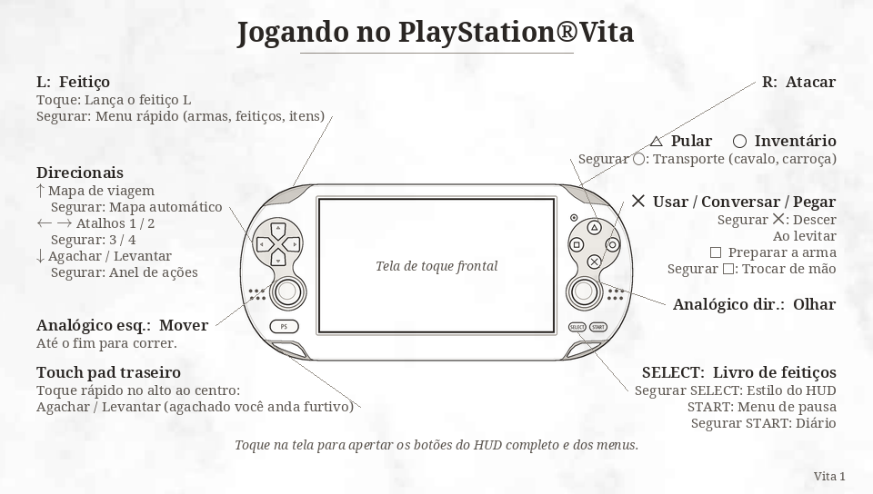
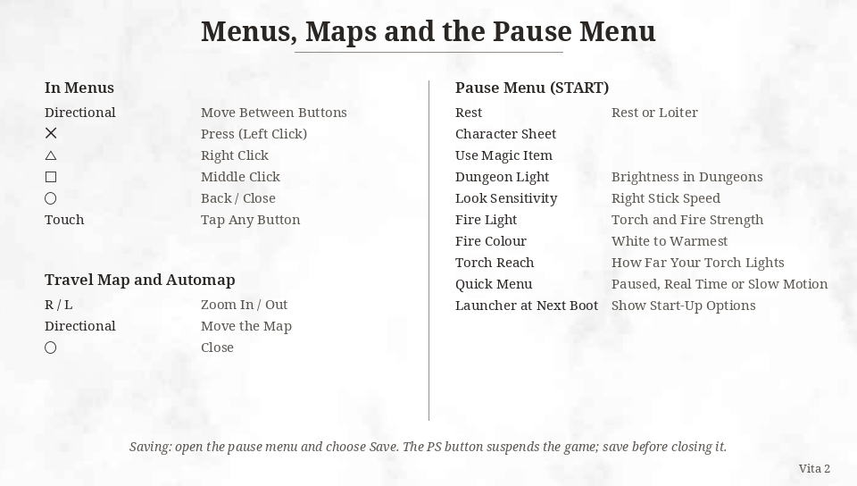
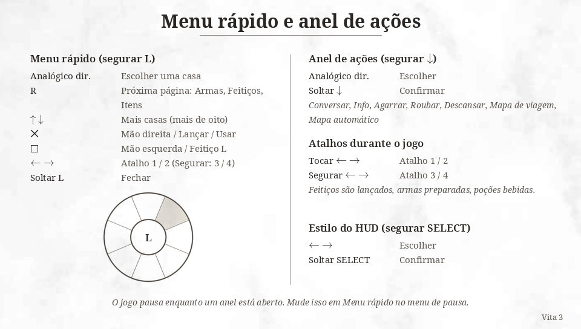

# Daggerfall Unity Vita

[English](README.md) | [Deutsch](README.de.md) | [Español](README.es.md) | [Français](README.fr.md) | [Italiano](README.it.md) | Português | [中文](README.zh.md)

*Este README foi traduzido do inglês com IA. Em caso de dúvida, vale a [versão em inglês](README.md). Só este README foi traduzido com IA: o jogo usa a tradução feita pelos tradutores do Daggerfall Unity, veja [Traduções](#traduções).*

<p align="center"></p>

Este é um port de [Daggerfall Unity](https://github.com/Interkarma/daggerfall-unity), a recriação de código aberto de The Elder Scrolls II: Daggerfall, para o *PS Vita*.

O port roda no próprio player Unity do Vita, então nada é emulado. Passei o código do upstream para o Unity 2018.2.19f1 e compilo com IL2CPP. O jogo roda na resolução nativa de 960x544. Quase todos os dados do jogo são convertidos num PC em pacotes feitos para o Vita e vão dentro do VPK, o que reduz o tempo de carregamento e o uso de memória.

É uma versão alfa, então espere bugs. Faça backup dos seus saves antes de atualizar.

## Novidades

### v.0.4.0-alpha

- Controles novos. Segure L para um menu rápido com suas armas, feitiços e itens, e segure baixo no direcional para um anel de ações com Conversar, Info, Agarrar, Roubar, Descansar e os mapas. Esquerda e direita no direcional guardam quatro atalhos. Veja [Controles](#controles). O manual na LiveArea também mostra o novo esquema.
- Os botões do Dragon Rider mudaram para combinar: R dispara um raio, e um toque em L dá uma batida de asas de velocidade. Veja [Controles do Dragon Rider](#controles-do-dragon-rider).
- VPK em português (Brasil, `DFU-pt.vpk`), traduzido pela Equipe Adaga.
- Mais rápido com mods: média de 56 FPS em vez de 49 nas mesmas 46 paradas, e todas as telas de carregamento somadas levam 85 s em vez de 150 s. Veja [Desempenho](#desempenho).
- 50 mudanças do Daggerfall Unity (upstream) incorporadas.
- Corrigido um travamento que acontecia ao lançar os mesmos feitiços várias vezes seguidas com muitos efeitos ativos.
- Dragon Rider: carregar um save feito em pleno voo coloca você de volta na mesma altura acima do chão.
- Árvores longe demais para serem vistas não são mais desenhadas, o que deixa as florestas mais rápidas.
- A sensibilidade da visão é maior por padrão. Dá para mudar no menu de pausa.

<details>
<summary>Versões anteriores</summary>

### v.0.3.2-alpha

Chinês, dois mods novos, um novo esquema do direcional e algumas correções.

- VPK em chinês (`DFU-zh.vpk`), traduzido por Czy2007.
- Dois mods novos, os dois desligados por padrão: Dragon Rider (relentlessp0sitivity e Kamer) e Travel Options (Hazelnut). Ligue pelo botão Mods na tela de configuração. Eles pesam no Vita e podem baixar a taxa de quadros. Veja [Controles do Dragon Rider](#controles-do-dragon-rider).
- No VPK chinês, as mensagens do Dragon Rider e a missão dele, The Stolen Egg, estão em chinês. As falas que o tradutor não cobriu ficam em inglês.
- Mensagens longas no topo da tela quebram para uma segunda linha em vez de sair pelas duas bordas.
- Direita no direcional abre o mapa de viagem, segurar abre o mapa automático, e baixo agacha ou levanta. Tocar o touchpad traseiro também continua agachando.
- No zoom mais próximo do mapa de viagem, o cursor escolhe o lugar para onde aponta, e não um algumas linhas abaixo.
- Com Dynamic Skies, a caixa clara em volta das luas sumiu, e os morros distantes no horizonte voltam a ser desenhados na frente de uma lua nascendo.

### v.0.3.1-alpha

Correções para as versões traduzidas e uma opção de taxa de quadros.

- Nova opção Taxa de quadros no menu de pausa: trave o jogo em 30 FPS para um ritmo uniforme, ou deixe livre.
- Rápido agora é a velocidade CPU/GPU padrão. Tirei o modo "Rápido, sem Wi-Fi" porque o Wi-Fi podia continuar desligado depois de sair do jogo. Se você tinha escolhido esse modo, agora fica com Rápido.
- Sair no menu de pausa agora sempre volta para a tela de título. Para fechar o jogo, use o botão PS.
- Janelas traduzidas não mostram mais pontos de interrogação perdidos, e linhas longas ficam na tela.
- Letras acentuadas na fonte pequena da interface não ficam mais abaixo da linha.
- Espanhol: imagens de menu refeitas, um título em espanhol no mapa de raças e correções em livros, perguntas de classe e alguns erros de digitação.

### v.0.3.0-alpha

Mods embutidos e mais quatro idiomas.

- Francês, alemão, italiano e espanhol, um VPK por idioma. Menus, livros, missões, diálogos, o mapa, imagens e legendas dos vídeos estão traduzidos.
- 21 mods embutidos no port, todos desligados até você ligar pelo botão Mods na tela de configuração. Veja [Mods](#mods).
- A tela de configuração abre na primeira vez que o jogo roda, para os jogadores novos acharem o botão Mods.
- Rótulos traduzidos longos encolhem para caber na caixa.
- Corrigida uma faixa cor de água em encostas distantes com World of Daggerfall - Terrain ligado.
- A página de configurações de vídeo não coloca mais Taxa de quadros em cima do botão Fechar.

### v.0.2.0-alpha

Principalmente um jogo mais fluido: as cidades são montadas aos poucos enquanto você anda, cidadãos escondidos param de se mexer, as músicas repetem sem travar, menos engasgos da coleta de lixo e uma câmera mais suave.

### v.0.1.0-alpha

- Primeira versão.

</details>

## Aviso

Daggerfall Unity Vita é um projeto de fãs não oficial. Não tem ligação com a Bethesda Softworks, a Sony ou a Unity, nem é endossado por elas.

Você precisa da sua própria cópia de Daggerfall para jogar. O Daggerfall de DOS é grátis na [Steam](https://store.steampowered.com/app/1812390/The_Elder_Scrolls_II_Daggerfall/).

Por favor, relate os bugs deste port aqui, não para a equipe do Daggerfall Unity.

## Instalação

Você precisa de um Vita com HENkaku ou Enso e o [VitaShell](https://github.com/TheOfficialFloW/VitaShell/releases) instalado, e cerca de 2 GB livres em `ux0:` para a instalação. O jogo e seus dados ocupam cerca de 1,4 GB depois que você apaga o VPK.

- Baixe um VPK da página de [Releases](https://github.com/GalvarinoDev/daggerfall-unity-vita/releases): `DFU-en.vpk` (inglês), `DFU-fr.vpk` (francês), `DFU-de.vpk` (alemão), `DFU-it.vpk` (italiano), `DFU-es.vpk` (espanhol), `DFU-pt.vpk` (português) ou `DFU-zh.vpk` (chinês). Instale com o VitaShell. Os sete são instalados como o mesmo app, então trocar de idioma mantém seus saves e configurações.
- Instale o Daggerfall de DOS no seu PC. Na Steam, a pasta de que você precisa é `DF/DAGGER/ARENA2`, dentro da pasta de instalação do jogo.
- Copie a pasta `ARENA2` inteira para o Vita, para ficar assim:

```
ux0:data/DaggerfallUnity/ARENA2
```

- Abra o jogo pela LiveArea. O carregamento do motor pode levar cerca de um minuto.

O manual original de 1996 vem junto. Abra com o botão Manual na tela LiveArea do jogo. O VPK italiano traz o manual italiano completo.

O jogo guarda os saves e as configurações em `ux0:data/DaggerfallUnity/UserData`.

## Controles

<p align="center"></p>
<p align="center"></p>
<p align="center"></p>

Um jogo novo começa com o HUD escondido. Segure Select para escolher um estilo de HUD, vá para a esquerda ou a direita para escolher um e solte. Numa caixa de texto, Triângulo abre o teclado do sistema de novo.

### Menu rápido (segurar L)

Segure L para abrir um anel com suas armas, feitiços e itens. Aponte para uma casa com o analógico direito e aperte R para trocar entre Armas, Feitiços e Itens. Se uma página tiver mais de oito coisas, cima e baixo no direcional mostram o resto. Solte L para fechar.

- Armas: X coloca a arma na mão direita e Quadrado na esquerda. Apertar o mesmo botão de novo tira a arma. A casa Trocar de mão troca as duas.
- Feitiços: X lança o feitiço. Quadrado faz dele o seu feitiço do L, que a partir daí você lança com um toque em L. A casa Livro de feitiços abre o livro de feitiços.
- Itens: X usa uma poção ou item mágico. Quadrado num item mágico coloca o poder dele no L.
- Atalhos: em qualquer página, toque esquerda ou direita no direcional para pôr a casa no atalho 1 ou 2, ou segure para o 3 ou o 4. Jogando, os mesmos toques e segurões usam os atalhos: feitiços são lançados, armas sacadas e poções bebidas.

Por padrão o jogo pausa enquanto o anel está aberto. Dá para mudar para tempo real ou câmera lenta em Menu rápido, no menu de pausa.

### Anel de ações (segurar baixo no direcional)

Segure baixo no direcional para um segundo anel com Conversar, Info, Agarrar, Roubar, Descansar, o mapa de viagem e o mapa automático. Aponte para um com o analógico direito e solte o baixo para escolher. Um toque rápido para baixo continua agachando ou levantando.

### Controles do Dragon Rider

Só valem se você ligar o mod Dragon Rider (ele vem desligado). Sem ele, os botões funcionam como mostrado acima.

- Ative seu dragão no modo Roubar ou Agarrar para montar, ou no modo Conversar para mandar ele seguir, esperar ou pegar uma gema. Também dá para montar e desmontar pelo menu de transporte (segurar Círculo).
- R dispara um raio do elemento do seu dragão. Toque em L para uma batida de asas de velocidade e continue tocando para manter. Segurar L continua abrindo o menu rápido.
- Triângulo sobe e X mergulha.
- Toque baixo no direcional para alternar entre pairar e voar.
- Dê um tranco forte no analógico esquerdo para o lado para desviar. Dois trancos fazem um parafuso.

## Mods

O Vita não consegue carregar os arquivos `.dfmod` de PC, então cada mod é convertido para ele. Ligue os mods pelo botão Mods na tela de configuração, antes de o jogo carregar. Os textos dos mods ficam em inglês em todos os idiomas, menos os do Dragon Rider no VPK chinês.

Se um mod der problema no Vita, o mais provável é que seja um erro meu na conversão. Por favor, relate aqui, não para o autor do mod.

Eu reempacoto cada mod para o Vita e só distribuo dentro das versões deste port, como mod opcional. As texturas vão para a paleta de 256 cores do Daggerfall ou para os formatos de textura do Vita e depois para atlas, e modelos, mapas e outros dados são convertidos para os pacotes do próprio port. Nunca compartilho os arquivos originais dos mods. Os autores mantêm todos os direitos sobre o trabalho deles e deram permissão só para este port (veja Licença).

Dragon Rider e Travel Options pesam no Vita e podem baixar a taxa de quadros.

<details>
<summary>Os 23 mods e seus autores</summary>

| Mod | Version | Por | Links |
|---|---|---|---|
| Basic Roads | 1.3.1 | Hazelnut | [Nexus](https://www.nexusmods.com/daggerfallunity/mods/134), [GitHub](https://github.com/ajrb/dfunity-mods) |
| Beautiful Cities of Daggerfall | 0.5.0 | carademono | [Nexus](https://www.nexusmods.com/daggerfallunity/mods/720) |
| Beautiful Villages of Daggerfall | 1.4.2 | carademono | [Nexus](https://www.nexusmods.com/daggerfallunity/mods/566), [GitHub](https://github.com/drcarademono/beautiful-villages) |
| Daggerfall Expanded Textures | 1.3.0 | Ninelan-Ruinar | [Nexus](https://www.nexusmods.com/daggerfallunity/mods/307) |
| DET Harvestable Crops | 1.0.1 | carademono, Ninelan e TheLacus | [Nexus](https://www.nexusmods.com/daggerfallunity/mods/882) |
| DIEP - Rosy's Resources | 1.1 | AlexanderSig, BenGamey974, PRAEst76 e RosyTheRascal | [Nexus](https://www.nexusmods.com/daggerfallunity/mods/1053) |
| Distant Terrain of the World of Daggerfall | 3.69 | MaoDeVaca, baseado em [Distant Terrain](https://www.nexusmods.com/daggerfallunity/mods/128) de Nystul | [Nexus](https://www.nexusmods.com/daggerfallunity/mods/1284) |
| Dragon Rider | 1.1 | relentlessp0sitivity e Kamer (SquidKamer) | [Nexus](https://www.nexusmods.com/daggerfallunity/mods/1334) |
| Dynamic Skies | 2.3.4 | BadLuckBurt e carademono | [Nexus](https://www.nexusmods.com/daggerfallunity/mods/376), [GitHub](https://github.com/drcarademono/dynamic-skies) |
| Finding My Religion | 1.23 | Cliffworms, com estátuas de King of Worms | [Nexus](https://www.nexusmods.com/daggerfallunity/mods/344) |
| Fixed Desert Architecture | 1.3.7 | Cliffworms | [Nexus](https://www.nexusmods.com/daggerfallunity/mods/333) |
| Fixed Dungeon Exteriors | 1.4.4 | Cliffworms | [Nexus](https://www.nexusmods.com/daggerfallunity/mods/225) |
| Low Poly Trees | 5 | Kamer (SquidKamer) | [Nexus](https://www.nexusmods.com/daggerfallunity/mods/380) |
| Redguards of Hammerfell | 0.6 | WilhelmBlack | [Nexus](https://www.nexusmods.com/daggerfallunity/mods/666) |
| RMB Resource Pack | 0.3.0 | muitos criadores, enviado por Cliffworms e mantido por carademono | [Nexus](https://www.nexusmods.com/daggerfallunity/mods/528), [GitHub](https://github.com/drcarademono/rmb-resource-pack) |
| Travel Options | 1.11 | Hazelnut | [Nexus](https://www.nexusmods.com/daggerfallunity/mods/122), [GitHub](https://github.com/ajrb/dfunity-mods) |
| Vanilla Friendly Loading Screens | 1.1 | WilhelmBlack | [Nexus](https://www.nexusmods.com/daggerfallunity/mods/838) |
| Windmills of Daggerfall | 2.2 | Kamer (SquidKamer) | [Nexus](https://www.nexusmods.com/daggerfallunity/mods/33) |
| World of Daggerfall | 0.4.0 | World of Daggerfall Team: carademono, Cliffworms, JayH e Kamer, com Location Loader de KABoissonneault e UncannyValley | [Nexus](https://www.nexusmods.com/daggerfallunity/mods/249), [GitHub](https://github.com/drcarademono/world-of-daggerfall), [Location Loader](https://github.com/KABoissonneault/DFU-LocationLoader) |
| World of Daggerfall - Biomes | 0.4.0 | carademono e KABoissonneault | [Nexus](https://www.nexusmods.com/daggerfallunity/mods/249), [GitHub](https://github.com/drcarademono/wod-biomes) |
| World of Daggerfall - Terrain | 1.5.0 | carademono, Freak2121, monobelisk e Ninelan | [Nexus](https://www.nexusmods.com/daggerfallunity/mods/249), [GitHub](https://github.com/drcarademono/wod-terrain) |

Pedi permissão ao autor ou responsável de cada mod. Quando não consegui falar com um autor, mas o mod está sob a licença MIT, ele entrou mesmo assim. Se você fez um desses mods e prefere que ele saia do port, abra uma issue e eu tiro.

Dois são novos para o Vita: Old Masters of Tamriel, uma coleção de pinturas em domínio público do Wikimedia Commons, e Snowless, que mantém pântanos, selvas e bosques verdes no inverno, com chuva em vez de neve.

World of Daggerfall - Terrain e Distant Terrain são os que mais custam taxa de quadros.

</details>

## Configurações de luz

<details>
<summary>Luz das masmorras, tochas e cor do fogo</summary>

Ficam na lista suspensa do menu de pausa. Cada clique passa a opção para o próximo valor, e a mudança vale na hora.

| Opção | Valores | Padrão |
|---|---|---|
| Luz das masmorras | 30%, 50%, 70%, 100% | 100% |
| Luz do fogo (tochas e lanternas) | 50%, 75%, 100%, 150%, 200% | 100% |
| Cor do fogo | Branco, Um pouco quente, Quente, Muito quente | Branco |
| Alcance da tocha | 6 m, 9 m, 12 m | 6 m |

Os valores padrão imitam a aparência do Daggerfall Unity no PC.

</details>

## Desempenho

<details>
<summary>Taxa de quadros e tempo de carregamento</summary>

Medido num PCH-1000 com a 0.4.0. Um bot visitou correndo as mesmas 46 paradas: uma masmorra, o campo aberto, e Daggerfall, Wayrest e Sentinel (ruas ao meio-dia e à noite, tavernas, lojas e palácios). Em cada parada vale a melhor de duas rodadas.

| | Sem mods | Todos os mods |
|---|---|---|
| Média | 59 FPS | 56 FPS |
| Tavernas, lojas, palácios, masmorra | 60 FPS | 60 FPS |
| Ruas da cidade | 52-60 FPS | 31-60 FPS |
| Campo aberto | 46-60 FPS | 51-60 FPS |
| Todas as telas de carregamento somadas | 81 s | 85 s |
| Carregamento mais longo | 11 s | 11 s |

Para comparar, a 0.3.2 tinha média de 58 FPS sem mods e 49 FPS com todos, e as telas de carregamento somavam 100 s e 150 s.

Nenhuma rodada travou. A configuração de velocidade padrão sobe a CPU para 444 MHz e o clock da GPU, e limita o brilho da tela. Você pode mudar isso em Velocidade CPU/GPU, no menu de pausa.

</details>

## Problemas conhecidos

- O castelo de Daggerfall ainda dá umas engasgadas em algumas portas.
- O navegador e a PlayStation Store não rodam junto com o jogo, porque ele usa o modo de memória extra do Vita.
- Os vídeos de substituição, o Post Processing e as fontes TextMeshPro do Daggerfall Unity de PC não estão disponíveis. As cenas originais continuam rodando.

## Compilar você mesmo

As instruções estão em inglês no [README em inglês](README.md#building-it-yourself).

## Créditos

- Minha namorada. Comecei o port porque ela ia pegar meu Vita emprestado quando fosse visitar a família neste Dia de Ação de Graças.
- [Interkarma](https://github.com/Interkarma), Daggerfall Workshop e todos que contribuíram com o [Daggerfall Unity](https://github.com/Interkarma/daggerfall-unity).
- Bethesda Softworks por The Elder Scrolls II: Daggerfall.

### Traduções

- Chinês: [Czy2007](https://www.nexusmods.com/daggerfallunity/users/230972787), [Chinese translation](https://www.nexusmods.com/daggerfallunity/mods/1418)
- Francês: [Daneel53](https://www.nexusmods.com/daggerfallunity/users/6838829) ([GitHub](https://github.com/Daneel53)) e Pango, [French Daggerfall](https://www.nexusmods.com/daggerfallunity/mods/456)
- Alemão: [Deepfighter](https://github.com/deepfighter) e Numenorean, [Daggerfall Deutsch](https://www.nexusmods.com/daggerfallunity/mods/826)
- Italiano: [XSpettro101X](https://www.nexusmods.com/profile/XSpettro101X?gameId=2927), com imagens e vídeos de [Rotary00](https://www.nexusmods.com/profile/Rotary00), [Traduzione Italiana](https://www.nexusmods.com/daggerfallunity/mods/1182)
- Português (Brasil): Equipe Adaga (Geavy, NecroBardo e Darkuby), enviado por [Antony827](https://www.nexusmods.com/profile/Antony827?gameId=2927), [Tradução de Daggerfall Unity](https://www.nexusmods.com/daggerfallunity/mods/565)
- Espanhol: [raulpuro](https://forums.dfworkshop.net/memberlist.php?mode=viewprofile&u=1633), com algumas falas da [tradução em espanhol](https://www.nexusmods.com/daggerfallunity/mods/1251) de [NarrodRecandriall](https://github.com/Narrod-Dev)

Adiciono outros idiomas com prazer se os tradutores concordarem. Se você fez uma tradução do Daggerfall Unity e gostaria de vê-la no Vita, abra uma issue aqui ou me mande mensagem no Discord Lysandus' Tomb: DFU Fan Server.

### Autores dos mods

Estes autores deixaram seus mods chegarem ao Vita. A página de cada mod está linkada em [Mods](#mods).

[AlexanderSig](https://www.nexusmods.com/profile/alexandersig?gameId=2927), [BadLuckBurt](https://github.com/BadLuckBurt), [BenGamey974](https://en.uesp.net/wiki/User:Bengamey_974), [carademono](https://www.nexusmods.com/daggerfallunity/users/107697598) ([GitHub](https://github.com/drcarademono)), [Cliffworms](https://www.nexusmods.com/daggerfallunity/users/13821) ([GitHub](https://github.com/Cliffworms)), [Freak2121](https://www.nexusmods.com/daggerfallunity/users/1626563) ([GitHub](https://github.com/Freak2121)), [Hazelnut](https://github.com/ajrb), [JayH](https://github.com/JayH2971), [KABoissonneault](https://www.nexusmods.com/daggerfallunity/users/5856175) ([GitHub](https://github.com/KABoissonneault)), [Kamer (SquidKamer)](https://github.com/SquidKamer), [King of Worms](https://www.nexusmods.com/profile/KingOfWormsDFU?gameId=2927), [MaoDeVaca](https://www.nexusmods.com/daggerfallunity/users/98208923), [monobelisk](https://www.nexusmods.com/daggerfallunity/users/14045140) ([GitHub](https://github.com/monobelisk)), [Ninelan-Ruinar](https://www.nexusmods.com/daggerfallunity/users/39888770), [Nystul](https://www.nexusmods.com/daggerfallunity/users/91388288) ([GitHub](https://github.com/Nystul-the-Magician)), [PRAEst76](https://www.nexusmods.com/daggerfallunity/users/56241), [RosyTheRascal](https://www.nexusmods.com/daggerfallunity/users/50021166), [TheLacus](https://github.com/TheLacus), [UncannyValley](https://forums.dfworkshop.net/memberlist.php?mode=viewprofile&u=72) e [WilhelmBlack](https://www.nexusmods.com/profile/WilhelmBlack?gameId=2927).

### Ajuda com o port

- [AJ](https://github.com/AJ170) e o servidor PS Vita Forever.
- [Vwing](https://github.com/Vwing) pelas ideias tiradas do port de Daggerfall Unity para Android que fez.
- [Kenney](https://www.kenney.nl) pelo pacote [Input Prompts](https://kenney.nl/assets/input-prompts) (CC0). Os ícones de botão do menu rápido são baseados nele.
- [shoui520](https://github.com/shoui520) pelo [vita-agent-use](https://github.com/shoui520/vita-agent-use). Usei para instalar builds de teste no meu Vita e deixar um bot andando por elas à noite, porque o jogo tem mais ou menos o tamanho do Reino Unido e não dá para eu visitar cada lugar sozinho. Assim apareceram muitos travamentos e lugares lentos.

## Licença

O código do port é MIT, igual ao Daggerfall Unity (upstream). Veja [LICENSE](./LICENSE).

A licença cobre só o código. Não cobre os dados do jogo nem os mods, convertidos ou não, e nenhum dos dois está neste repositório. Os mods pertencem aos autores, que deram permissão só para este port, então quem quiser usá-los num fork ou em qualquer outro lugar tem que pedir aos autores primeiro.
