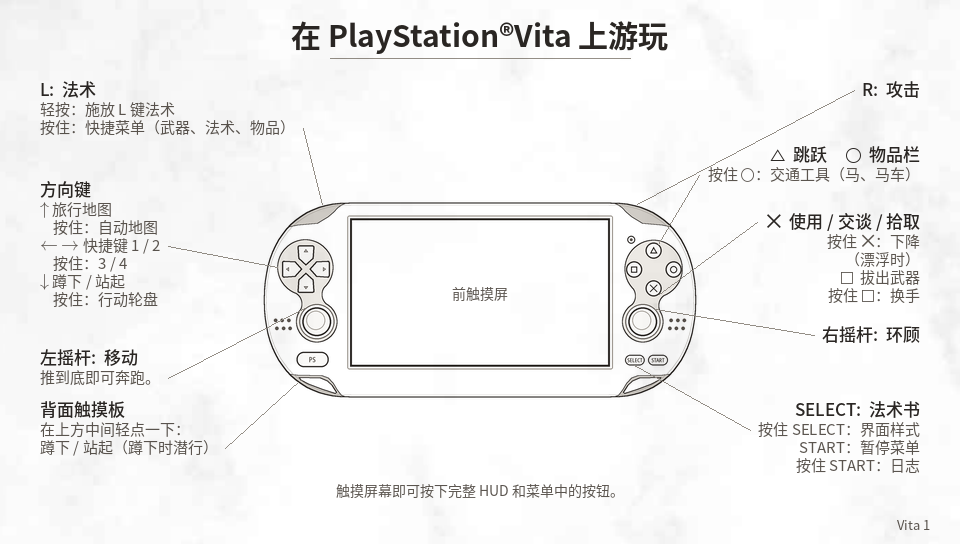
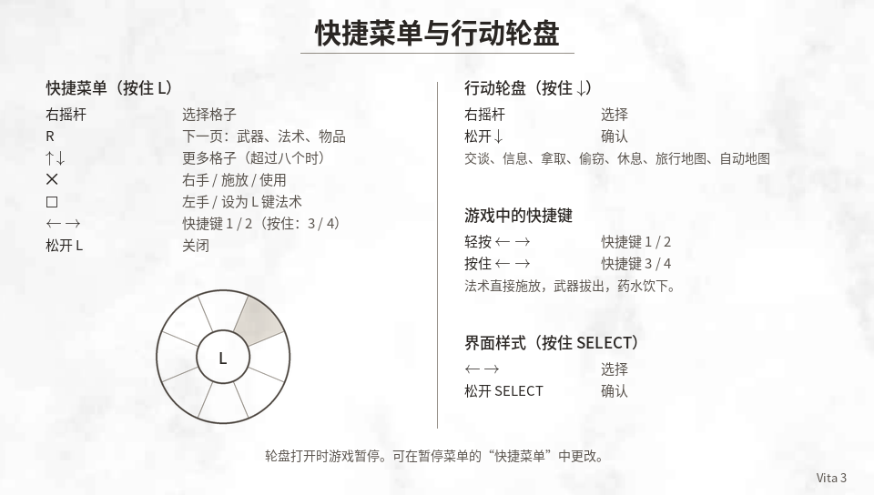

# Daggerfall Unity Vita

[English](README.md) | [Deutsch](README.de.md) | [Español](README.es.md) | [Français](README.fr.md) | [Italiano](README.it.md) | [Português](README.pt.md) | 中文

*本 README 由 AI 从英文翻译而来。如有出入，以[英文版](README.md)为准。只有这份 README 是 AI 翻译的，游戏本身用的是 Daggerfall Unity 译者的人工翻译，见[翻译](#翻译)。*

<p align="center"></p>

这是 [Daggerfall Unity](https://github.com/Interkarma/daggerfall-unity)（《上古卷轴 II：匕首雨》的开源重制）在 *PS Vita* 上的移植版。

移植版运行在 Vita 自己的 Unity 播放器上，没有任何模拟。我把上游代码移植回 Unity 2018.2.19f1，用 IL2CPP 编译，游戏以 960x544 原生分辨率渲染。大部分游戏数据在 PC 上预先转换成专为 Vita 做的数据包，放在 VPK 里，以缩短读取时间、减少内存占用。

这是 alpha 版，难免有 bug。更新前请备份存档。

## 更新日志

### v.0.4.0-alpha

- 全新操作。按住 L 打开快捷菜单，里面有你的武器、法术和物品；按住十字键下打开行动轮盘，里面有交谈、信息、拿取、偷窃、休息和地图。十字键左右可放四个快捷键。见[操作](#操作)。LiveArea 里的说明书也换成了新的按键布局。
- Dragon Rider 的按键也相应改了：R 发射元素弹，轻按 L 扇一下翅膀加速。见 [Dragon Rider 操作](#dragon-rider-操作)。
- 新增葡萄牙语（巴西）VPK（`DFU-pt.vpk`），由 Equipe Adaga 翻译。
- 开启 mod 时更快：同样 46 个地点平均从 49 FPS 提高到 56 FPS，所有读取画面加起来从 150 秒缩短到 85 秒。见[性能](#性能)。
- 合并了上游 Daggerfall Unity 的 50 项更改。
- 修复了反复施放同样的法术、身上效果很多时游戏卡死的问题。
- Dragon Rider：读取在飞行中保存的存档时，会回到离地面同样的高度。
- 远到看不见的树不再绘制，森林里更流畅。
- 视角灵敏度默认调高了，可以在暂停菜单里修改。

<details>
<summary>更早的版本</summary>

### v.0.3.2-alpha

中文、两个新 mod、新的十字键布局和一些修复。

- 中文 VPK（`DFU-zh.vpk`），由 Czy2007 翻译。
- 两个新 mod，默认都关闭：Dragon Rider（relentlessp0sitivity 和 Kamer）和 Travel Options（Hazelnut）。在设置界面的 Mods 按钮里开启。它们在 Vita 上负担较重，可能降低帧率。见 [Dragon Rider 操作](#dragon-rider-操作)。
- 中文 VPK 里，Dragon Rider 的提示和它的任务 The Stolen Egg 是中文的。译者没翻译的句子保持英文。
- 屏幕顶部的长消息会换到第二行，不再从两边超出屏幕。
- 十字键右打开旅行地图，按住打开自动地图，十字键下蹲下或站起。轻点背面触摸板仍然可以蹲下。
- 旅行地图放到最大时，光标选中的是它指着的地方，而不是下面几行的地方。
- 开启 Dynamic Skies 时，月亮周围的浅色方框没有了，地平线上的远山又会画在升起的月亮前面。

### v.0.3.1-alpha

翻译版本的修复，以及帧率选项。

- 暂停菜单新增“帧率”选项：锁定 30 FPS 让画面更平稳，或者不锁。
- CPU/GPU 频率默认改为“快速”。我去掉了“快速，关闭 Wi-Fi”模式，因为退出游戏后 Wi-Fi 可能保持关闭。之前选了它的会改为“快速”。
- 暂停菜单里的“退出”现在总是回到标题画面。要关闭游戏请用 PS 键。
- 翻译后的弹窗不再出现多余的问号，长句也不会跑出屏幕。
- 界面小字体里带重音的字母不再掉到行下面。
- 西班牙文：重新制作了菜单图片的文字，种族地图上有了西班牙文标题，并修正了书籍、职业问答和一些错字。

### v.0.3.0-alpha

内置 mod 和另外四种语言。

- 法文、德文、意大利文和西班牙文，每种语言一个 VPK。菜单、书籍、任务、对话、地图、图片和影片字幕都已翻译。
- 移植版内置 21 个 mod，全部默认关闭，需在设置界面的 Mods 按钮里开启。见[模组](#模组)。
- 第一次启动时会打开设置界面，方便新玩家找到 Mods 按钮。
- 较长的翻译标签会缩小以放进框里。
- 修复了开启 World of Daggerfall - Terrain 时远处山坡上出现水色条带的问题。
- 视频设置页面不再把“帧率”压在“关闭”按钮上。

### v.0.2.0-alpha

主要是更流畅：走路时城镇一点点建起来，看不见的市民停止移动，歌曲循环时不再卡住，垃圾回收造成的卡顿更少，镜头更平稳。

### v.0.1.0-alpha

- 首次发布。

</details>

## 声明

Daggerfall Unity Vita 是非官方的粉丝项目，与 Bethesda Softworks、Sony 和 Unity 均无关联，也未获得它们的认可。

你需要自己拥有一份 Daggerfall 才能游玩。DOS 版 Daggerfall 在 [Steam](https://store.steampowered.com/app/1812390/The_Elder_Scrolls_II_Daggerfall/) 上免费。

这个移植版的 bug 请在这里反馈，不要报给 Daggerfall Unity 团队。

## 安装

你需要一台运行 HENkaku 或 Enso、装有 [VitaShell](https://github.com/TheOfficialFloW/VitaShell/releases) 的 Vita，安装时 `ux0:` 上需要约 2 GB 空闲空间。删掉 VPK 后，游戏和数据约占 1.4 GB。

- 从 [Releases](https://github.com/GalvarinoDev/daggerfall-unity-vita/releases) 页面下载一个 VPK：`DFU-en.vpk`（英文）、`DFU-fr.vpk`（法文）、`DFU-de.vpk`（德文）、`DFU-it.vpk`（意大利文）、`DFU-es.vpk`（西班牙文）、`DFU-pt.vpk`（葡萄牙文）或 `DFU-zh.vpk`（中文），用 VitaShell 安装。七个版本都安装成同一个应用，所以换语言不会丢存档和设置。
- 在电脑上安装 DOS 版 Daggerfall。Steam 版需要的文件夹是游戏安装目录里的 `DF/DAGGER/ARENA2`。
- 把整个 `ARENA2` 文件夹复制到 Vita，最后路径应为：

```
ux0:data/DaggerfallUnity/ARENA2
```

- 从 LiveArea 启动游戏。引擎加载可能需要一分钟左右。

附带 1996 年的原版说明书，在游戏 LiveArea 界面点“说明书”按钮即可打开。意大利文 VPK 里是完整的意大利文说明书。

存档和设置保存在 `ux0:data/DaggerfallUnity/UserData`。

## 操作

<p align="center"></p>
<p align="center"></p>
<p align="center"></p>

新游戏开始时界面（HUD）是隐藏的。按住 Select 选择界面样式，左右移动挑一个，然后松开。在文本框里按三角键可以重新打开系统键盘。

### 快捷菜单（按住 L）

按住 L 打开一个轮盘，里面是你的武器、法术和物品。用右摇杆指向一个格子，按 R 在武器、法术、物品之间切换。一页超过八样时，十字键上下可以看到其余的。松开 L 关闭。

- 武器：叉键把武器放到右手，方块键放到左手。再按一次同一个键就卸下。“换手”格子会交换左右手。
- 法术：叉键施放法术。方块键把它设为 L 法术，之后轻按 L 就能施放。“法术书”格子打开法术书。
- 物品：叉键使用药水或魔法物品。在魔法物品上按方块键，把它的能力设到 L 上。
- 快捷键：在任意一页上，轻按十字键左或右把格子放到快捷键 1 或 2，按住则放到 3 或 4。游戏中用同样的轻按和按住来使用：施放法术、拔出武器、喝下药水。

默认情况下，轮盘打开时游戏暂停。可以在暂停菜单的“快捷菜单”里改成实时或慢动作。

### 行动轮盘（按住十字键下）

按住十字键下打开第二个轮盘，里面有交谈、信息、拿取、偷窃、休息、旅行地图和自动地图。用右摇杆指向一个，松开十字键下即可选择。轻按一下十字键下仍然是蹲下或站起。

### Dragon Rider 操作

只有开启 Dragon Rider mod 时才适用（默认关闭）。不开时按键和上面一样。

- 在偷窃或拿取模式下对你的龙使用即可骑上去；在交谈模式下可以让它跟随、等待或拿一颗宝石。也可以在交通菜单（按住圆圈键）里上下龙。
- R 发射你的龙所属元素的弹。轻按 L 扇一下翅膀加速，连续轻按可以保持速度。按住 L 仍然打开快捷菜单。
- 三角键上升，叉键俯冲。
- 轻按十字键下在悬停和飞行之间切换。
- 把左摇杆猛地推向一侧可以闪避，连推两次是桶滚。

## 模组

Vita 无法加载 PC 的 `.dfmod` 文件，所以每个 mod 都专门为它做了转换。在游戏加载前，从设置界面的 Mods 按钮开启。所有语言版本里 mod 的文字都保持英文，只有中文 VPK 里的 Dragon Rider 例外。

如果某个 mod 在 Vita 上出问题，多半是我转换时出了错。请在这里反馈，不要去找 mod 作者。

我为 Vita 重新打包每个 mod，只放在这个移植版的发布里，作为可选 mod。贴图转成 Daggerfall 的 256 色调色板或 Vita 自己的贴图格式，再合进图集；模型、地图和其他数据转换成移植版自己的数据包。我从不分发 mod 的原始文件。作者保留对作品的全部权利，他们只授权了这个移植版使用（见许可证）。

Dragon Rider 和 Travel Options 在 Vita 上负担较重，可能降低帧率。

<details>
<summary>全部 23 个 mod 及作者</summary>

| Mod | Version | 作者 | 链接 |
|---|---|---|---|
| Basic Roads | 1.3.1 | Hazelnut | [Nexus](https://www.nexusmods.com/daggerfallunity/mods/134), [GitHub](https://github.com/ajrb/dfunity-mods) |
| Beautiful Cities of Daggerfall | 0.5.0 | carademono | [Nexus](https://www.nexusmods.com/daggerfallunity/mods/720) |
| Beautiful Villages of Daggerfall | 1.4.2 | carademono | [Nexus](https://www.nexusmods.com/daggerfallunity/mods/566), [GitHub](https://github.com/drcarademono/beautiful-villages) |
| Daggerfall Expanded Textures | 1.3.0 | Ninelan-Ruinar | [Nexus](https://www.nexusmods.com/daggerfallunity/mods/307) |
| DET Harvestable Crops | 1.0.1 | carademono、Ninelan 和 TheLacus | [Nexus](https://www.nexusmods.com/daggerfallunity/mods/882) |
| DIEP - Rosy's Resources | 1.1 | AlexanderSig、BenGamey974、PRAEst76 和 RosyTheRascal | [Nexus](https://www.nexusmods.com/daggerfallunity/mods/1053) |
| Distant Terrain of the World of Daggerfall | 3.69 | MaoDeVaca、基于 Nystul 的 [Distant Terrain](https://www.nexusmods.com/daggerfallunity/mods/128) | [Nexus](https://www.nexusmods.com/daggerfallunity/mods/1284) |
| Dragon Rider | 1.1 | relentlessp0sitivity 和 Kamer (SquidKamer) | [Nexus](https://www.nexusmods.com/daggerfallunity/mods/1334) |
| Dynamic Skies | 2.3.4 | BadLuckBurt 和 carademono | [Nexus](https://www.nexusmods.com/daggerfallunity/mods/376), [GitHub](https://github.com/drcarademono/dynamic-skies) |
| Finding My Religion | 1.23 | Cliffworms，雕像由 King of Worms 制作 | [Nexus](https://www.nexusmods.com/daggerfallunity/mods/344) |
| Fixed Desert Architecture | 1.3.7 | Cliffworms | [Nexus](https://www.nexusmods.com/daggerfallunity/mods/333) |
| Fixed Dungeon Exteriors | 1.4.4 | Cliffworms | [Nexus](https://www.nexusmods.com/daggerfallunity/mods/225) |
| Low Poly Trees | 5 | Kamer (SquidKamer) | [Nexus](https://www.nexusmods.com/daggerfallunity/mods/380) |
| Redguards of Hammerfell | 0.6 | WilhelmBlack | [Nexus](https://www.nexusmods.com/daggerfallunity/mods/666) |
| RMB Resource Pack | 0.3.0 | 众多素材作者，由 Cliffworms 上传、carademono 维护 | [Nexus](https://www.nexusmods.com/daggerfallunity/mods/528), [GitHub](https://github.com/drcarademono/rmb-resource-pack) |
| Travel Options | 1.11 | Hazelnut | [Nexus](https://www.nexusmods.com/daggerfallunity/mods/122), [GitHub](https://github.com/ajrb/dfunity-mods) |
| Vanilla Friendly Loading Screens | 1.1 | WilhelmBlack | [Nexus](https://www.nexusmods.com/daggerfallunity/mods/838) |
| Windmills of Daggerfall | 2.2 | Kamer (SquidKamer) | [Nexus](https://www.nexusmods.com/daggerfallunity/mods/33) |
| World of Daggerfall | 0.4.0 | World of Daggerfall 团队：carademono、Cliffworms、JayH 和 Kamer，Location Loader 由 KABoissonneault 和 UncannyValley 制作 | [Nexus](https://www.nexusmods.com/daggerfallunity/mods/249), [GitHub](https://github.com/drcarademono/world-of-daggerfall), [Location Loader](https://github.com/KABoissonneault/DFU-LocationLoader) |
| World of Daggerfall - Biomes | 0.4.0 | carademono 和 KABoissonneault | [Nexus](https://www.nexusmods.com/daggerfallunity/mods/249), [GitHub](https://github.com/drcarademono/wod-biomes) |
| World of Daggerfall - Terrain | 1.5.0 | carademono、Freak2121、monobelisk 和 Ninelan | [Nexus](https://www.nexusmods.com/daggerfallunity/mods/249), [GitHub](https://github.com/drcarademono/wod-terrain) |

每个 mod 我都向作者或项目负责人征求过许可。有的作者联系不上，但 mod 使用 MIT 许可证，所以仍然收录了。如果你是其中某个 mod 的作者，希望把它从移植版中移除，请开一个 issue，我会删掉。

有两个是为 Vita 新做的：Old Masters of Tamriel，一组来自 Wikimedia Commons 的公有领域名画；Snowless，让沼泽、丛林和林地在冬天保持绿色，下雨而不下雪。

World of Daggerfall - Terrain 和 Distant Terrain 最耗帧率。

</details>

## 光照设置

<details>
<summary>地牢亮度、火把和火光颜色</summary>

这些选项在暂停菜单的下拉列表里。每点一次切换到下一个值，立即生效。

| 选项 | 可选值 | 默认 |
|---|---|---|
| 地牢亮度 | 30%、50%、70%、100% | 100% |
| 火光亮度（火把和灯笼） | 50%、75%、100%、150%、200% | 100% |
| 火光颜色 | 白色、略暖、暖色、很暖 | 白色 |
| 火把照明范围 | 6 米、9 米、12 米 | 6 米 |

默认值与 PC 版 Daggerfall Unity 的效果一致。

</details>

## 性能

<details>
<summary>帧率和读取时间</summary>

在一台 PCH-1000 上用 0.4.0 测得。一个机器人以跑步速度走过同样的 46 个地点：一座地牢、野外，以及 Daggerfall、Wayrest 和 Sentinel（正午和夜晚的街道、酒馆、商店和宫殿）。每个地点取两轮中较好的一次。

| | 不开 mod | 全部 mod |
|---|---|---|
| 平均 | 59 FPS | 56 FPS |
| 酒馆、商店、宫殿、地牢 | 60 FPS | 60 FPS |
| 城市街道 | 52-60 FPS | 31-60 FPS |
| 野外 | 46-60 FPS | 51-60 FPS |
| 所有读取画面合计 | 81 秒 | 85 秒 |
| 最长单次读取 | 11 秒 | 11 秒 |

作为对比，0.3.2 不开 mod 平均 58 FPS，全开 49 FPS，读取画面合计分别为 100 秒和 150 秒。

所有测试都没有崩溃。默认的速度设置会把 CPU 提到 444 MHz、提高 GPU 频率，并限制屏幕亮度。可以在暂停菜单的“CPU/GPU 频率”里修改。

</details>

## 已知问题

- Daggerfall 城堡里有些门口仍会短暂卡顿。
- 游戏使用了 Vita 的额外内存模式，所以运行时无法同时使用网页浏览器和 PlayStation Store。
- PC 版 Daggerfall Unity 的替换视频、Post Processing 和 TextMeshPro 字体不可用。原版过场动画照常播放。

## 自行编译

编译说明只有英文，见[英文 README](README.md#building-it-yourself)。

## 致谢

- 我的女朋友。我开始做这个移植，是因为她今年感恩节回家看家人时要借我的 Vita。
- [Interkarma](https://github.com/Interkarma)、Daggerfall Workshop 以及 [Daggerfall Unity](https://github.com/Interkarma/daggerfall-unity) 的所有贡献者。
- Bethesda Softworks 和《上古卷轴 II：匕首雨》。

### 翻译

- 中文：[Czy2007](https://www.nexusmods.com/daggerfallunity/users/230972787)，[Chinese translation](https://www.nexusmods.com/daggerfallunity/mods/1418)
- 法文：[Daneel53](https://www.nexusmods.com/daggerfallunity/users/6838829)（[GitHub](https://github.com/Daneel53)）和 Pango，[French Daggerfall](https://www.nexusmods.com/daggerfallunity/mods/456)
- 德文：[Deepfighter](https://github.com/deepfighter) 和 Numenorean，[Daggerfall Deutsch](https://www.nexusmods.com/daggerfallunity/mods/826)
- 意大利文：[XSpettro101X](https://www.nexusmods.com/profile/XSpettro101X?gameId=2927)，图片和影片由 [Rotary00](https://www.nexusmods.com/profile/Rotary00) 制作，[Traduzione Italiana](https://www.nexusmods.com/daggerfallunity/mods/1182)
- 葡萄牙文（巴西）：Equipe Adaga（Geavy、NecroBardo 和 Darkuby），由 [Antony827](https://www.nexusmods.com/profile/Antony827?gameId=2927) 上传，[Tradução de Daggerfall Unity](https://www.nexusmods.com/daggerfallunity/mods/565)
- 西班牙文：[raulpuro](https://forums.dfworkshop.net/memberlist.php?mode=viewprofile&u=1633)，部分台词来自 [NarrodRecandriall](https://github.com/Narrod-Dev) 的[西班牙文翻译](https://www.nexusmods.com/daggerfallunity/mods/1251)

只要译者同意，我很乐意加入更多语言。如果你做过 Daggerfall Unity 的翻译，想放到 Vita 上，可以在这里开 issue，或在 Discord 服务器 Lysandus' Tomb: DFU Fan Server 上联系我。

### Mod 作者

这些作者允许他们的 mod 来到 Vita。每个 mod 的页面链接见[模组](#模组)。

[AlexanderSig](https://www.nexusmods.com/profile/alexandersig?gameId=2927), [BadLuckBurt](https://github.com/BadLuckBurt), [BenGamey974](https://en.uesp.net/wiki/User:Bengamey_974), [carademono](https://www.nexusmods.com/daggerfallunity/users/107697598) ([GitHub](https://github.com/drcarademono)), [Cliffworms](https://www.nexusmods.com/daggerfallunity/users/13821) ([GitHub](https://github.com/Cliffworms)), [Freak2121](https://www.nexusmods.com/daggerfallunity/users/1626563) ([GitHub](https://github.com/Freak2121)), [Hazelnut](https://github.com/ajrb), [JayH](https://github.com/JayH2971), [KABoissonneault](https://www.nexusmods.com/daggerfallunity/users/5856175) ([GitHub](https://github.com/KABoissonneault)), [Kamer (SquidKamer)](https://github.com/SquidKamer), [King of Worms](https://www.nexusmods.com/profile/KingOfWormsDFU?gameId=2927), [MaoDeVaca](https://www.nexusmods.com/daggerfallunity/users/98208923), [monobelisk](https://www.nexusmods.com/daggerfallunity/users/14045140) ([GitHub](https://github.com/monobelisk)), [Ninelan-Ruinar](https://www.nexusmods.com/daggerfallunity/users/39888770), [Nystul](https://www.nexusmods.com/daggerfallunity/users/91388288) ([GitHub](https://github.com/Nystul-the-Magician)), [PRAEst76](https://www.nexusmods.com/daggerfallunity/users/56241), [RosyTheRascal](https://www.nexusmods.com/daggerfallunity/users/50021166), [TheLacus](https://github.com/TheLacus), [UncannyValley](https://forums.dfworkshop.net/memberlist.php?mode=viewprofile&u=72) 和 [WilhelmBlack](https://www.nexusmods.com/profile/WilhelmBlack?gameId=2927).

### 移植帮助

- [AJ](https://github.com/AJ170) 和 PS Vita Forever 服务器。
- [Vwing](https://github.com/Vwing)：我借鉴了 Vwing 的 Daggerfall Unity 安卓移植里的一些思路。
- [Kenney](https://www.kenney.nl) 的 [Input Prompts](https://kenney.nl/assets/input-prompts) 素材包（CC0）。快捷菜单里的按键图标以它为基础。
- [shoui520](https://github.com/shoui520) 的 [vita-agent-use](https://github.com/shoui520/vita-agent-use)。我用它把测试版装到 Vita 上，夜里让一个自动行走的机器人跑遍游戏，因为游戏世界差不多有英国那么大，我没法亲自去每个地方。这样找出了很多崩溃和卡顿的地方。

## 许可证

移植版的代码采用 MIT 许可证，与上游 Daggerfall Unity 相同。见 [LICENSE](./LICENSE)。

许可证只涵盖代码，不涵盖游戏数据和 mod（无论是否转换过），这两者都不在本仓库里。mod 属于各自的作者，他们只授权了这个移植版，所以想在 fork 或其他地方使用的人，必须先征得作者同意。
